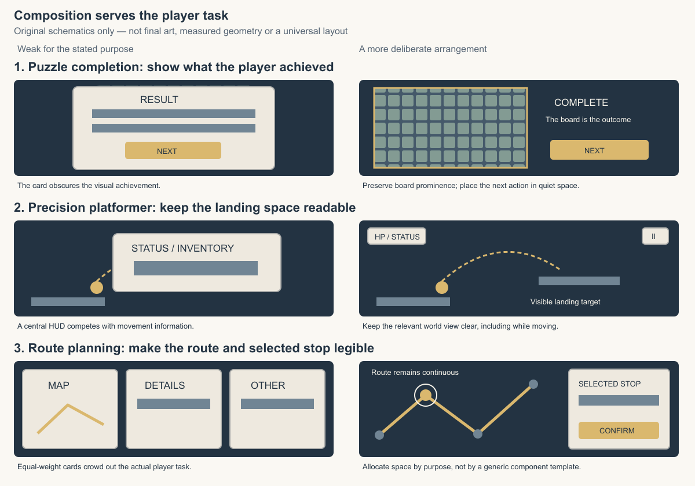

# Screen Composition Studies

Use this reference when establishing or substantially revising a screen/scene composition. A narrow text, binding or input fix does not require a reference search or visual sample. The examples illustrate decisions, not required layouts, extra game features or an aesthetic scoring system.

## Learn from a relevant reference

Prefer a small set of actual screenshots, scenes or assets comparable in player action, camera/view, information density and target device. If reference access is unavailable, describe the provisional decision and its uncertainty rather than pretending to have inspected a game.

For the part being designed, explain what earns attention first, what makes the primary action readable, and how the game imagery and UI share space. Extract useful relationships: subject prominence, value contrast, typography, silhouette, material and resource families. State what is unsuitable for this game. A name such as "premium", "cozy" or "like game X" is not that analysis. Use the reference for the applicable part, not as a reason to import unrelated controls or gameplay.

Useful open-source examples, each with a different lesson:

- [Mindustry's menu](https://github.com/Anuken/Mindustry/blob/master/core/src/mindustry/ui/fragments/MenuFragment.java) places controls over its [game-world menu renderer](https://github.com/Anuken/Mindustry/blob/master/core/src/mindustry/graphics/MenuRenderer.java). This illustrates world/UI continuity, not a universal demand for a moving background or its exact menu arrangement.
- [Unciv's skin documentation](https://github.com/yairm210/Unciv/blob/master/docs/Modders/Creating-a-UI-skin.md) connects reusable shapes, nine-patch images and tint to specific UI elements. This illustrates a concrete visual family instead of independently styling each button; check current capabilities before adopting its implementation details.
- [Veloren's model guide](https://book.veloren.net/contributors/artists/voxel-models.html) points contributors to actual assets/reference models and explains scale. This illustrates how a usable sample and proportional context communicate more than style adjectives; its voxel proportions are not rules for other games.

These are methodological inferences from the cited projects, not proof that copying them improves taste. Inspect the relevant visuals when using them as visual references. Source and asset licenses are separate: studying composition is not permission to copy images, fonts or branding into a deliverable.

## Three contrasting composition examples

View the PNG when using these comparisons; the [editable SVG](composition-studies.svg) is its original source. The diagrams are simplified explanations, not screenshots, final artwork or validated runtime layouts. "After" serves the stated purpose; it is not universally better than the other arrangement.

| Example and purpose | Weak choice for that purpose | More deliberate choice | What must survive in layout/resources |
|---|---|---|---|
| Puzzle completion: let the player appreciate the board they completed | A generic statistics card covers the board, leaving the actual achievement unseen | Keep the finished board prominent; attach a concise outcome and next action in quiet space | Board visibility and relative size, clear next action, and a completion treatment on the board itself |
| Precision platformer: read landing space while moving | A large central status panel competes with the trajectory and landing target | Keep necessary status compact near a suitable edge and preserve the relevant world view | Landing/trajectory visibility during play, legible cues at target size, and motion that does not mask hazards |
| Route-planning game: compare routes and inspect a selected stop | Equally emphasized cards compete with a small map and make the route hard to follow | Give the route map sufficient space; place contextual detail where it supports the selected stop | Continuous readable route, distinct selection, useful detail, and clear confirmation without covering needed map information |

Different requirements can justify a large card, prominent HUD or smaller map. Choose from the actual player task, not a ban on those components. Use shape/value/spacing before adding texture and glow; decoration should reinforce the intended subject, not make every region equally loud.

## Carry the decision into a usable sample

Record the chosen focal subject, relative prominence, action placement and quiet regions in the existing art/UI design source. Do not add a separate report or duplicate per-viewport coordinate tables. Use actual scene/UI geometry for an existing render; for an image model, provide both layout and art direction and label which governs positions versus appearance. Distinguish inspiration from an agreed composition. A generated image can suggest treatment and reveal a composition weakness, but cannot certify exact rectangles, fonts or interaction.

Inspect the smallest complete composition that answers the uncertainty, using existing assets or explicitly provisional critical samples. Check the same player-facing state at the intended size: did the focal subject shrink or disappear, did a panel cover necessary world information, or did the main action lose emphasis? Correct only the affected source when the evidence supports it, then inspect the changed view when available. Do not freeze an unsatisfactory first layout merely because geometry checks pass, or automatically regenerate all screens/resources.

Before propagating a visual treatment, make its resource family concrete where needed: representative shape/material, real font or explicit candidate, meaningful control/object states, and the intended scale/crop or stretch behavior. Pending assets remain pending. A wireframe checks hierarchy; a polished reference is not proof of its implementation; a still image cannot validate motion, focus or input. Missing observations stay unverified, and this method does not authorize paid generation, an extra reviewer or a fixed approval stage.
