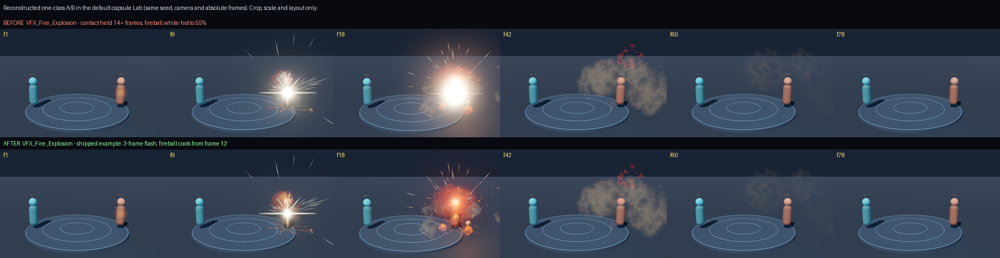
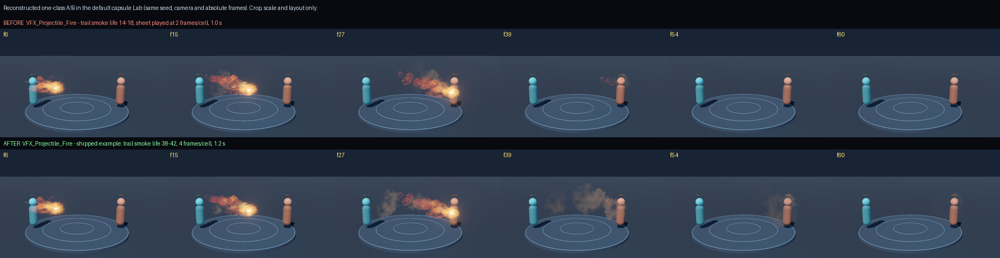
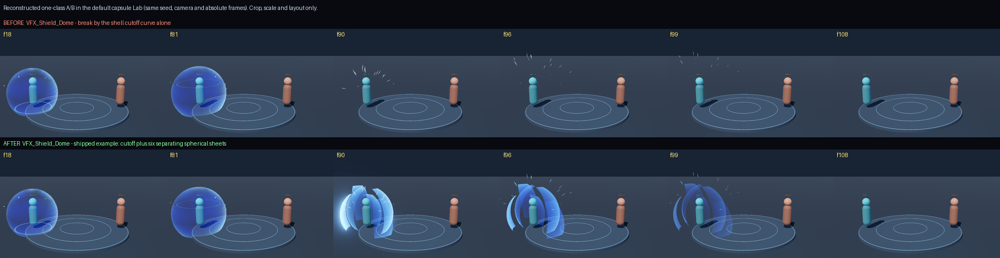

# VFX craft and diagnosed cases

Use the relevant section when constructing an effect or diagnosing its appearance. Start from the game's established style and feedback purpose. The examples below teach causal relationships, not required effects, layer counts, numeric budgets or additional approval steps.

## Choose the representation from the visible change

Describe the first readable shape, its size relative to the subject, the meaningful change and what remains at the end. For a complex transformation, sketch those key moments before choosing resources; a new brief file is unnecessary. A light contact can be one short cue. A charge gathers before release; a heal may rise softly; neither needs an explosion's flash and debris.

| Visible need | Useful representation | Boundary |
| --- | --- | --- |
| Light falloff, noise, emission, trails, flowing or eroding masks | Existing engine particles, geometry and material/shader facilities | These mathematical and compositing operations are normal VFX methods, not a reason to redraw unrelated artwork. A ring or flash may legitimately use only transforms and opacity. |
| Painted fire, smoke, slash strokes or detailed material shapes | Suitable supplied, library, Web or authorized AI-produced textures/sequences under the existing source policy | Runtime scaling and tint do not create missing painted detail or required silhouette changes. Use the system imagegen Skill if image generation is selected. |
| Continuous rolling, tearing or material transformation | A suitable existing sequence; an authored or generated flipbook; optionally a video-derived sequence when a usable clip or authorized video capability exists | A generated clip is not mandatory. Check available tools before choosing the path; this reference installs no video service. |
| A body animation with contact accents, reactive sparks or ground residue | A texture/sequence combined with engine-driven layers | Keep only layers that add necessary information or material behavior. A complete clip may already satisfy a simple effect. |

## Shape, value and timing

Separate brightness from volume. An explosion can become dimmer while its body keeps expanding and rising; prolonging the white flash hides that body. A sustained shield can keep a stable silhouette while surface flow changes. Shape change may come from a sweep, erosion, distortion, geometry breakup or different drawn frames, according to the intended material. Scaling and fading alone are insufficient when rolling, tearing or fracture is the intended visible action.

Use value roles where useful: a brief highlight or hot edge, a colored body, and darker backing or matter that keeps the form readable. More additive layers or bloom can wash out the subject; black additive pixels cannot supply opaque soot or a dark silhouette. Choose alpha blending, additive emission and depth/order for each role in the actual renderer. Their exact APIs, axes and HDR values are engine-specific. A soft glow, heal or optical cue need not have an attack-style white core, dark outline or broken edge.

Give the main motion a cause and direction: a slash follows the action plane; falling fragments differ from rising smoke; a charge can draw inward. Organize speed and decay to express the material instead of uniformly moving every particle. Elements may differ in shape, motion and material when the design calls for distinct identities; no minimum number of differences is a pass criterion.

For animation-led attacks, use the real action/contact events and their timing for the relevant cues, not independently guessed timers. A projectile head may follow its owner while its trail stays where emitted. Stop new emission on arrival or cancellation while existing trail instances finish when that is intended. Use the current game's movement, hit and clock ownership; a VFX launch helper is not a substitute for authoritative collision.

Choose volume from the player camera: a tilted slash plane, ground footprint or near/far layers may carry more spatial information than another camera-facing card. Apparent weight depends on relative size, motion and decay as well as geometry scale; the source project's giant-scale formulas are not cross-engine defaults. Use the existing runtime observation for the affected action at gameplay size; a labeled strip can compare shapes and placement, while playback answers cadence. Correct file fields do not establish a visible transformation.

## Effect textures and sequences

Choose texture roles before generation or extraction: colored body, opacity mask, light, distortion input or frame animation. Shape, motion span, intended display size and complete extents determine frame count, cell shape and layout. Static effect parts may share an atlas; a flipbook instead needs an ordered temporal sequence. Neither a fixed square grid nor a character action-pose template applies to every effect.

For a video-derived sequence, first choose the useful action span or one loop period. Keep the camera stable and isolate the effect when generating a clip; a burst needs its intended exit and a loop needs a compatible seam. Extract with one shared crop and coordinate reference across the selected frames, preserving the intended root/contact point. Per-frame tight cropping and recentering create apparent jitter or erase purposeful travel. Choose separation and filtering for the actual consumer. Reuse the [existing frame preparation methods](ai-sprite-animation.md#inspect-and-prepare-frames-from-any-source) without imposing character pose requirements on VFX.

Use actual alpha when supplied. Black-background extraction based on brightness can work for emissive light but can erase dark smoke, soot or shaded body parts; an arbitrary mask can also cut off meaningful tips or sparks. Choose suitable source transparency, segmentation or separate body/emission layers for the material instead of treating black-to-alpha as universal background removal. Confirm straight versus premultiplied alpha with the actual blend mode. Preserve useful soft edges and dark body values over the game's background.

Align playback span, frame timing and instance lifetime: a particle can remain alive after its sheet has already reached blank frames. A longer duration alone cannot create a visible tail. Keep source originals and use the project's existing resource/animation records for derived frames and timing. Video extraction needs available decoding tools; it does not authorize installing dependencies, generating a clip or buying a replacement.

## Diagnosed visual cases

Open the matching image only for the current defect. These are the upstream project's reconstructed before/after renders in its Godot capsule Lab, with the same seed, camera and absolute frame labels. They are not BGS test results or footage of the historical debugging sessions. Their fixed parameters and backgrounds are not targets for another game.

### A flash hides the explosion body

At f18 the upper row is a white mass; the lower row has handed emphasis to an orange-red body. Later smoke frames are similar. First inspect the contact/core duration, body color curve and overlapping additive/glow layers. Shorten or cool the overlong bright stretch before adding particles or dark backing. Compare the handoff after contact in the affected game rather than copying this example's three-frame flash.

### The projectile arrives and its trail disappears

The head reaches the same point at f27. At f39 the upper row has almost lost the path, while the lower still carries a cooling trail. Diagnose owner inheritance, immediate destruction, emitted-instance life and sheet playback separately. If the trail is meant to remain, release emission and let the relevant world-space instances decay; extending the overall effect duration without visible material does not repair it. A fast clean projectile need not leave a long trail.

### A shield switches off instead of breaking

The upper shield is whole at f81 and absent by f90; the lower shows spatial gaps and separating pieces through f90–99. First verify the cutoff/material combination in the selected renderer. If it does not produce the required breakup, a suitable material or segmented geometry can realize it. The source later identified a Godot-plugin cutoff-curve issue; this does not establish that dissolve fails in other engines. Also inspect the eventual exit: this strip's dim remnants near f108 do not alone prove complete cleanup. A shield intended simply to fade needs no fracture treatment.

## Sources and reuse boundary

Adapted from [effekseer-vfx-skill at b0eea108](https://github.com/Phantomxm2021/effekseer-vfx-skill/tree/b0eea1085f2e3e0fa0b5cc77c58c9a845f0bec96): [design](https://github.com/Phantomxm2021/effekseer-vfx-skill/blob/b0eea1085f2e3e0fa0b5cc77c58c9a845f0bec96/skills/effekseer-vfx/references/design.md), [layering](https://github.com/Phantomxm2021/effekseer-vfx-skill/blob/b0eea1085f2e3e0fa0b5cc77c58c9a845f0bec96/skills/effekseer-vfx/references/layering.md), [video flipbooks](https://github.com/Phantomxm2021/effekseer-vfx-skill/blob/b0eea1085f2e3e0fa0b5cc77c58c9a845f0bec96/skills/effekseer-vfx/references/video-flipbook.md) and [diagnosed cases](https://github.com/Phantomxm2021/effekseer-vfx-skill/blob/b0eea1085f2e3e0fa0b5cc77c58c9a845f0bec96/skills/effekseer-vfx/references/cases.md). The three case images are unmodified copies under the upstream MIT license; see [license](vfx-cases/LICENSE.txt).

This reference transfers production judgment and examples. It does not install Effekseer, Godot, Unity or their compiler/runtime APIs, and does not import the source project's mandatory briefs, fixed iteration rounds, scoring, pixel thresholds, evidence ledger or independent-review gates. Use facilities and permissions available in the selected target engine.
