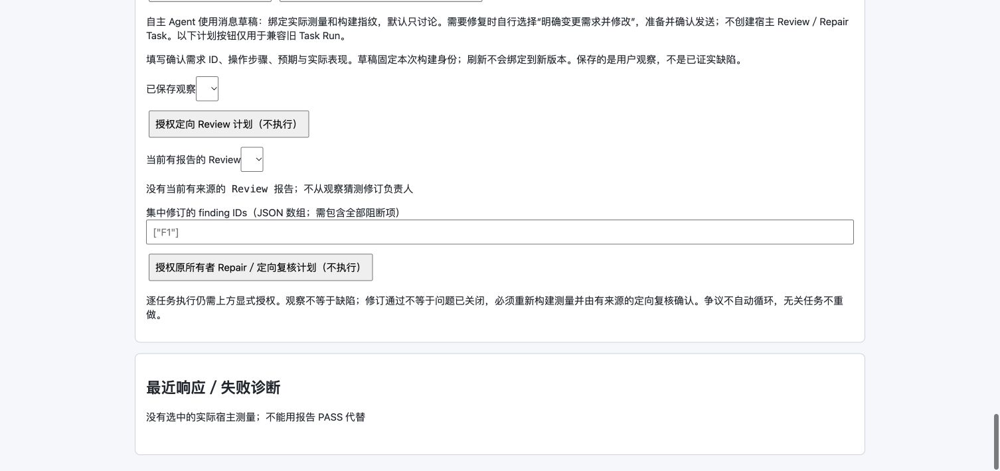

# 磁轨调度：V3 付费续验审计

日期：2026-10-11。结论：**未通过、已暂停，不能交付为合格游戏**。没有人工修补游戏。所有源码、设计和数据变化均来自正常 BGS 原生 Agent；本代理只读复核并另外保存审计。

## 1. 范围与真实收尾

- 工程：`/Users/nswell/Documents/PhantomsXR/Projects/InternalProjects/Others/BeeGameStudio/Projects/users/30fb0202-1f77-414f-82da-f92936e7bba3/v3-agent-acceptance--1b167e40f20a`。
- 复用原项目、原 Chat、原 native UUID；正常用户 Cookie、根环境和真实数据库。没有新 idea、宿主 Task、自动重试或轮数限额。
- 第一轮从 05:01:29 UTC 恢复。发现生成器写 public/content、检查器读 content 的实际输入错位后，正常 debug 暂停并核对退出；原始失败保留。以正常同工程续作消息反馈该已查证事实，未提供人工替代文档或游戏代码。
- 第二轮从 05:24:17 UTC 续作。05:32:51 原生报告 compacting，十分钟未返回，也没有当前 measurement；本代理通过正常 debug 暂停，不再追加付费执行。这是一次诊断处置，不是系统自动限额，不能把未完成算通过。
- 最终 Run v20，status=blocked，保留 paused；最后写者 05:43:03.997 UTC 已退出，无 writer，deliveryEligible=false。四个原生回合的 UUID 一致。
- 原生进程写入全局 .npm/_logs 的一次请求，经正常工具权限接口拒绝，Agent 后改用项目目录。未扩大权限。两次暂停与一次路径反馈均明示，故本组**不是完全无人工反馈的自主能力基准**。

## 2. 四项交付核对

| 项目 | 实际发现 | 判定 |
|---|---|---|
| 设计记录 | 八领域文件已由 Agent 集中到 docs/，补了决定／实现对应。但正文仍留旧规则和无充分证明的结论，见下表 | 部分完成，不合格 |
| Scene/UI | 根 content/index.json 登记 3 个 Scene、6 个 UI；旧副本与硬编码关卡表已清理。新增运行加载、UI 构造和构建复制代码 | 产出与部分数据消费已证实；像素级编辑一致性未验收 |
| 资源 | 资源桥真实查询返回非空目录；Agent 比较候选后选择 Canvas／WebAudio 程序化资源，没有下载／付费生图 | 选择可合理，不等于成品质量达标；实际资源表现未验收 |
| 游戏品质 | 当前三关可行回放及错送／冲突负例通过；类型检查失败，没有当前已测候选、完整试玩或听感证据 | 未通过，不能发布 |

程序化资源不是缺陷，也不要求为满足“获取资源”而强行采购。本轮不能证明画面有品味、反馈清楚或声音合格。

## 3. 已查证的问题及归因

| 级别 | 问题／证据 | 原因与边界 |
|---|---|---|
| P1 | [src/content.ts:163](/Users/nswell/Documents/PhantomsXR/Projects/InternalProjects/Others/BeeGameStudio/Projects/users/30fb0202-1f77-414f-82da-f92936e7bba3/v3-agent-acceptance--1b167e40f20a/src/content.ts:163) 类型错误；独立 tsc --noEmit 退出 2 | Agent 运行消费重构未完成；不是 BGS 构建器误判。没有手改测试工程修复 |
| P1 | [src/content.ts:219](/Users/nswell/Documents/PhantomsXR/Projects/InternalProjects/Others/BeeGameStudio/Projects/users/30fb0202-1f77-414f-82da-f92936e7bba3/v3-agent-acceptance--1b167e40f20a/src/content.ts:219) 将数字字号直接转成不带单位的 CSS 字符串；已保存 UI 例如 fontSize=40 | 消费者没有忠实实现已有数据语义。实际最终像素尚未测量，但该赋值缺陷可从源码确认 |
| P1 | [src/content.ts:80](/Users/nswell/Documents/PhantomsXR/Projects/InternalProjects/Others/BeeGameStudio/Projects/users/30fb0202-1f77-414f-82da-f92936e7bba3/v3-agent-acceptance--1b167e40f20a/src/content.ts:80) 只读取 camera.viewport；[src/content.ts:107](/Users/nswell/Documents/PhantomsXR/Projects/InternalProjects/Others/BeeGameStudio/Projects/users/30fb0202-1f77-414f-82da-f92936e7bba3/v3-agent-acceptance--1b167e40f20a/src/content.ts:107) 直接取节点 x/y；[src/content.ts:251](/Users/nswell/Documents/PhantomsXR/Projects/InternalProjects/Others/BeeGameStudio/Projects/users/30fb0202-1f77-414f-82da-f92936e7bba3/v3-agent-acceptance--1b167e40f20a/src/content.ts:251) 拉伸 sizeDelta 用作同向 margin | Scene 相机中心／缩放与 UI 几何语义未完整消费。当前固定布局可能看起来可用，不能据此承诺编辑器修改正确生效。现存画面的具体影响仍未测量 |
| P2 | [docs/BALANCE_DESIGN.md:21](/Users/nswell/Documents/PhantomsXR/Projects/InternalProjects/Others/BeeGameStudio/Projects/users/30fb0202-1f77-414f-82da-f92936e7bba3/v3-agent-acceptance--1b167e40f20a/docs/BALANCE_DESIGN.md:21) 保留 5/10/13，后文与数据为 5/14/17；[docs/GDD.md:31](/Users/nswell/Documents/PhantomsXR/Projects/InternalProjects/Others/BeeGameStudio/Projects/users/30fb0202-1f77-414f-82da-f92936e7bba3/v3-agent-acceptance--1b167e40f20a/docs/GDD.md:31)／UI／美术仍写 1–4，实际第三关有 5 道岔 | 文档修订只追加部分新结论，没有关闭受影响旧条款。统一目录／版本号不能证明内容一致 |
| P2 | [docs/BALANCE_DESIGN.md:25](/Users/nswell/Documents/PhantomsXR/Projects/InternalProjects/Others/BeeGameStudio/Projects/users/30fb0202-1f77-414f-82da-f92936e7bba3/v3-agent-acceptance--1b167e40f20a/docs/BALANCE_DESIGN.md:25) 将可行回放称为“最少操作”；[docs/ASSET_PLAN.md:4](/Users/nswell/Documents/PhantomsXR/Projects/InternalProjects/Others/BeeGameStudio/Projects/users/30fb0202-1f77-414f-82da-f92936e7bba3/v3-agent-acceptance--1b167e40f20a/docs/ASSET_PLAN.md:4) 仍写资源库未配置，后文又记录非空目录复核 | 证据被过度解读、旧理由残留；脚本只证明所选序列可行，不证明最优／全部状态 |
| P1（成本） | 第 65 次起仍生成 public/content，但 checker 检查根 content；多次补组件却没有改变被检查文件 | Agent 未核对实际输入，产生无效返工。暂停后由作者统一来源；不能将这些额外组件当作真实渲染证据 |
| 执行遗漏 | 第一轮 77 请求没有 Skill 调用；第二轮只实际加载 content-pipeline 一项 | Skills 已提供不等于实际使用；属于可观察的执行遗漏，不证明模型能力绝对无解 |
| 待查 | native compacting 后十分钟没有结果／用量 | 已保留原始状态；未证实是模型服务、原生压缩还是其他原因，不以等待时长直接宣布系统 bug |

无头回放只覆盖：三关所给序列、L1 错送、L2 汇流冲突。没有证明任意错误道岔、所有边界时序、最优操作、UI 点击完整路径或真机体验。

## 4. Token 用量

本轮新增 **12,403,170 Token 已报告下限**；此前 **4,358,327**，项目累计下限 **16,761,497**。不是完整账单，不估算人民币。原生压缩未返回用量；历史还有中断请求，不能把这些未知消耗当作零。

| 本轮类别 | Token |
|---|---:|
| 非缓存输入 | 286,747 |
| 缓存历史输入 | 12,053,960 |
| 输出 | 62,463 |
| cache creation | 0（已报告） |

96 个可观察普通请求均有 stop_reason；两个业务回合却都 interrupted。普通请求完整不等于整轮完成，更不覆盖没有返回 usage 的压缩。

| 工作段（按工具行为归类，不是固定业务阶段） | 请求 | Token |
|---|---:|---:|
| 工具／格式／目录探查 | 1–12（12次） | 1,111,213 |
| 文档迁移与逐条修订 | 13–41（29次） | 3,257,178 |
| Scene/UI 生成及越界写入处理 | 42–54（13次） | 1,707,797 |
| 来源路径、版本字段与布局调整 | 55–64（10次） | 1,415,375 |
| 几何诊断返工（第65次起生成器仍写旧副本） | 65–77（13次） | 1,929,852 |
| 同工程续作：来源清理、运行消费重构和测试 | 78–96（19次） | 2,981,755 |

第一轮 9,421,415；续作 2,981,755。约 **97.2%** 为缓存输入。第一次新请求输入 84,303，最后一次普通请求输入 166,908；大多数请求只有一个小操作。首轮未批量关闭旧条款、同一关卡文档连续 10 次读写、工具格式与错误探索、错位副本反复检查，均被长历史放大。没有证据说明 BGS 重新倾倒全部 brief、强制八作者或自动收费重试；也不是主要花在输出文档。

逐请求输入／缓存／输出、工具操作、来源前后指纹及四回合用量见同名 JSON；不累加多次累计 usage 事件。

## 5. 回归与保护范围

- 系统边界回归：5 文件、48 pass／0 fail、514 assertions，25.23 秒；包括真实 CLI＋本机固定响应器，不能升级为真实模型游戏品质。
- 根 tsconfig 全工程类型检查退出 0；游戏工程独立类型检查退出 2（见上）。独立运行作者保存的无头测试：6 条断言通过，未写入游戏文件。
- 正式 apps/frontend、Claude Code src、packages/builtin-tools 前后整树 SHA-256 一致；既有修改保留。本轮没有更改系统源码、正式 UI 或原生 CLI，没有重建 CLI。
- 只替换上轮已暂停的专用付费验收 host；缺失资源服务以临时目录／下载服务恢复，批量资源处理未启用。正常产品服务未重启。临时进程仅在确认原生退出后收尾。
- 实施文档 1.43 已按字节归档，归档 SHA-256=3fdc069b9d590f05992fb294f18939d628ca00f6dfada4a33974d8bb123cfa05。旧失败历史不改写。

## 6. 下一步（不靠无限付费修订）

1. 先查明原生 compacting 未返回的实际请求／取消证据；不改 Claude Code 的压缩实现，也不设隐藏轮数上限。
2. 审核现有 Content 运行消费辅助能力是否可按需复用，避免作者重新猜相机／锚点／字号语义；明确真实根目录与版本字段入口。先验证可复用接口，不另建游戏引擎或强制技术路线。
3. 文档检查围绕实际变更关闭旧条款、区分可行／最优与已测／未测；不要新增全量文档审批阶段或依赖另一份模型 PASS。
4. 当前未完成工程仅由正常 BGS 原生流程继续修订；下一次付费执行前明确是否继续本组，不能人工补一个能过的版本。最终须有当前构建、JSON 修改消费反例、代表画面／完整交互和实际音频证据。

## 附：本轮逐请求操作

| # | 总 Token（含缓存） | 实际操作 |
|---:|---:|---|
| 1 | 84,750 | TodoWrite |
| 2 | 86,216 | List project tree and check-content help |
| 3 | 86,610 | Show check-content tool help |
| 4 | 88,510 | List content format sections |
| 5 | 88,747 | Read index and runtimeConsumption format sections |
| 6 | 89,777 | Read UI and scene document format sections |
| 7 | 94,348 | Read scene vocabulary component types |
| 8 | 94,615 | Read scene vocabulary via temp file |
| 9 | 95,631 | Show assets and measure tool help |
| 10 | 96,406 | Browse asset library catalog for train assets |
| 11 | 102,374 | Read UI vocabulary roles |
| 12 | 103,229 | TodoWrite |
| 13 | 103,665 | Move eight design records into docs/ |
| 14 | 104,218 | Bump all design docs to version 2.0 |
| 15 | 104,923 | Remove duplicate date in version line |
| 16 | 105,395 | docs/LEVEL_SCENE_DESIGN.md |
| 17 | 105,554 | docs/LEVEL_SCENE_DESIGN.md |
| 18 | 106,197 | docs/LEVEL_SCENE_DESIGN.md |
| 19 | 106,435 | docs/LEVEL_SCENE_DESIGN.md |
| 20 | 107,366 | docs/LEVEL_SCENE_DESIGN.md |
| 21 | 107,807 | docs/LEVEL_SCENE_DESIGN.md |
| 22 | 108,995 | docs/LEVEL_SCENE_DESIGN.md |
| 23 | 109,539 | docs/LEVEL_SCENE_DESIGN.md |
| 24 | 109,861 | docs/LEVEL_SCENE_DESIGN.md |
| 25 | 110,240 | docs/LEVEL_SCENE_DESIGN.md |
| 26 | 110,614 | docs/BALANCE_DESIGN.md |
| 27 | 111,107 | docs/BALANCE_DESIGN.md |
| 28 | 112,012 | docs/BALANCE_DESIGN.md |
| 29 | 112,636 | docs/BALANCE_DESIGN.md |
| 30 | 113,763 | docs/TECHNICAL_DESIGN.md |
| 31 | 113,936 | docs/TECHNICAL_DESIGN.md |
| 32 | 115,554 | docs/TECHNICAL_DESIGN.md |
| 33 | 115,964 | Show tail lines of remaining docs |
| 34 | 116,707 | Append traceability section to GDD |
| 35 | 117,838 | Append v2.0 traceability sections to art/audio/UI docs |
| 36 | 119,093 | Append asset review and technical traceability |
| 37 | 120,085 | docs/ASSET_PLAN.md |
| 38 | 120,243 | docs/ASSET_PLAN.md |
| 39 | 121,326 | docs/ASSET_PLAN.md |
| 40 | 121,975 | docs/README.md |
| 41 | 124,130 | TodoWrite |
| 42 | 125,146 | /Users/nswell/.npm/_logs/gen-scenes.ts |
| 43 | 125,338 | Create scripts directory in project |
| 44 | 126,377 | scripts/gen-scenes.ts |
| 45 | 126,635 | Generate scene JSON documents |
| 46 | 128,957 | public/content/ui/title.json |
| 47 | 130,115 | public/content/ui/level-select.json |
| 48 | 132,246 | public/content/ui/hud.json |
| 49 | 132,543 | public/content/ui/hud.json |
| 50 | 133,861 | public/content/ui/success.json |
| 51 | 135,213 | public/content/ui/fail.json |
| 52 | 136,523 | public/content/ui/ending.json |
| 53 | 137,251 | public/content/index.json |
| 54 | 137,592 | Validate content package |
| 55 | 138,194 | Move content to root and re-validate |
| 56 | 138,935 | content/index.json |
| 57 | 139,088 | content/index.json |
| 58 | 139,512 | content/index.json |
| 59 | 140,021 | Re-validate content package with revisions |
| 60 | 143,012 | content/index.json |
| 61 | 143,564 | Adjust HUD geometry for 960px viewport and stretch hints |
| 62 | 143,939 | Fix hint bar vertical offset |
| 63 | 144,367 | scripts/gen-scenes.ts |
| 64 | 144,743 | scripts/gen-scenes.ts |
| 65 | 145,057 | Regenerate scenes and revalidate |
| 66 | 145,599 | Inspect HUD linked scene projection details |
| 67 | 146,148 | Batch review linked scene/UI layouts with report |
| 68 | 146,618 | Inspect review command output |
| 69 | 147,120 | Read scene inspection details from report |
| 70 | 147,327 | Inspect report JSON structure |
| 71 | 148,023 | Read sceneNote and deferred diagnostics |
| 72 | 148,936 | Test rect-transform for visibility bounds |
| 73 | 149,529 | Read scene visibility contract format |
| 74 | 150,172 | Regenerate and run scene layout inspection |
| 75 | 151,156 | Add box colliders and recheck scene visibility |
| 76 | 151,585 | Recheck scene layouts after collider addition |
| 77 | 152,582 | Search scene vocabulary for geometry source semantics |
| 78 | 142,556 | Compare root/public content copies and generator output path |
| 79 | 144,329 | bgs-builtins:game-content-pipeline-engineer |
| 80 | 145,184 | TodoWrite |
| 81 | 146,042 | Normalize scenes, remove duplicates and old scaffolding |
| 82 | 149,688 | src/content.ts |
| 83 | 150,530 | vite.config.ts |
| 84 | 155,828 | src/game.ts |
| 85 | 156,679 | src/content.ts |
| 86 | 157,158 | src/content.ts |
| 87 | 158,436 | src/main.ts |
| 88 | 158,849 | index.html |
| 89 | 161,189 | src/styles.css |
| 90 | 161,722 | src/main.ts |
| 91 | 164,035 | tests/headless-sim.ts |
| 92 | 164,318 | Type-check after content pipeline rework |
| 93 | 165,075 | src/content.ts |
| 94 | 166,397 | src/main.ts |
| 95 | 166,688 | Type check and run headless tests against content |
| 96 | 167,052 | src/content.ts |
