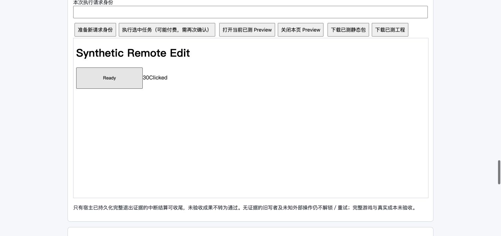

# V3 自主编辑：远端存储与独立部署验收

日期：2026-10-11。对应规范：1.43、§9.13。

## 结论

本轮完成 **真实 Supabase + 正常用户登录 + 本机独立部署服务** 上的自主编辑闭环：
保存 Scene/UI → 旧测量失效 → 显式同工程消息 → 原生 CLI 构建/测量 → 实际页面消费 → 工程导出/重建 → 服务重启后读取。
没有改业务执行器来配合样本。新增的是独立验收脚本，不是新业务框架。

这是合成工程运输/版本链路验收，**不是八领域设计、专业 Skill 使用、画面/音频品质或真实模型成本通过**。发布资格始终 false。

## 实际入口与身份

- 脚本：`scripts/verify-workflow-v3-agent-edit.ts`。要求显式 `--apply --env-file PATH --source-project OWNED_ID`；恢复使用 `--resume-project SYNTHETIC_ID`。
- 仅创建带固定 synthetic 名称的新项目，工作区必须为系统临时目录下 `bgs-v3-agent-edit-*` 的直接子目录；既有真实项目仅读取 owner/workspace 元数据。
- 新增验收项目：`v3-agent-edit-4892f9a6-3482-4217-b017-518939691a63`；Run：`ea33cd64-d2e5-49bf-a0b9-de92795ee64d`。
- 合成工作区：`/private/var/folders/77/bcfcrwjj1yg90qkfj3pbnyr00000gn/T/bgs-v3-agent-edit-DE8fNL`。
- 真实 CLI、正常项目鉴权/HttpOnly Cookie、正常 V3 路由、真实远端 CAS；没有管理员 currentUser 替身、dev token、预填 Task 或伪造测量结果。
- 模型唯一入口由该合成 runner 固定为本机 Anthropic 协议响应器：每回合 Read UI → Read Scene → Bash 调用本回合真实 measure 入口 → 结束。模型回复固定，构建/浏览器测量不是固定结果。
- 原生会话 UUID：`c7377ef8-f7cf-4be5-9574-938bacf85db8`，两回合相同。
- 首次有效服务端口 62445，重启后 62879；验收结束均已停止。本轮正常服务、旧付费服务及真实工程未重启/未改写。

## 证据与验收

| 项目 | 实测结果 |
| --- | --- |
| 接完整目标 | 正常 debug 接单；plans/Task 均为空，初始 planRevision=0 |
| 初次构建/测量 | 原生 CLI 实际调用 measure；build 与 runtime-smoke 均 passed |
| UI 保存 | 正常数据 API 把 play 高度 52 改为 64；原字节留存，保存记录持久化到真实数据库 |
| Scene 保存 | board.x 从 0 改为 30；独立留存原字节与保存记录 |
| 不偷偷执行 | 两次保存后 agentTurns 仍为 1；全程未创建 Task |
| 旧资格失效 | 测量 freshness=false；旧 Preview、工程导出均 HTTP 409 measurement-stale |
| 显式变更 | 同工程授权消息生成需求新版本，沿用同一原生 UUID；只新增 1 个原生回合 |
| 新资格来源 | 新测量绑定最后 sourceEditId `94723a2c-fa13-4653-8da3-bda8e4b8d287`；freshness=true |
| 真消费 | Chrome 的已测 Preview 等待 JSON 加载后，按钮实际 200×64、Scene 输出 30，点击输出 Clicked。不是仅检查 JSON 请求成功 |
| 可编辑工程 | 正常界面导出 13,236 字节 ZIP；9 份源文件哈希逐项等于测量记录，无 host 会话/归档/凭据 |
| 解压重建 | 导出包解压到新临时目录执行 bun run build，退出 0；产物哈希与原测量相同 |
| 无关结果保留 | 7 份无关源文件字节不变；包括 notes、docs/README、index、构建脚本、入口与 manifest；两份原稿归档哈希均匹配 before |
| 重启恢复 | Run version=17、2 个源保存记录、2 个原生回合、0 Task、无 writer 不变；新测量仍 current，新 Preview 实际消费仍正确 |
| 无自动重做 | 重启后的固定模型请求为 0；没有再次构建或新测量 |
| 品质不冒充 | deliveryEligible=false、quality=unverified 保留 |

初始产物哈希：`c1d587ad2fd3a37b7edba29709a74647bc6926963af26d3272df0ce7067b7060`。
新产物及解压重建哈希：`3516648fd0a9c020eb4a88b00a1a82ffd487700d6cbcf78695b669fbf2e2c586`。

原始远端 Run 副本：[JSON](bgs-v3-remote-source-edit-run-2026-10-11.json)。
浏览器截图仅表示合成数据消费，不表示游戏画面品质：

## 消耗与未隐瞒的失败

- 两次有效回合共 **8 次本机假模型请求**，合成 usage=120 Token（固定每请求 10 输入、5 输出），**不能用于估算真实成本或宣称 Token 降幅**；真实付费模型调用 0。读取、保存、失效检查、导出、重启不调用模型。
- 此独立进程设置 billing disabled，未连接真实计费客户端；旧 outbox 机制仍保存合成用量并报 pending 警告，记录留在合成 host 目录，未据此宣称计费链路通过；正常服务配置不变。
- 首个合成项目 `v3-agent-edit-574a5b04-b750-4ca7-b86e-feb4649ea014`：验收脚本误用 runner 输入中不存在的 projectId，原生进程未启动。已改为实际 cwd + 已保存 Run.chatSessionId 校验，未放宽正常业务权限。首轮失败/零 usage 保留；无原生历史时续作正确返回 conversation-unavailable，没有伪造恢复记录。后续创建独立合成记录，不把首轮抹成通过。
- 初次回归在受限沙箱中无法启动真实 Chromium，停止该运行；同源码在允许本机浏览器进程的环境重验通过。
- 包内 tsconfig 缺根路径映射，不能独立承载根工程检查；该命令失败未当作通过。根配置类型检查及临时扩展根配置包含本次脚本均退出 0，临时配置已移除。
- Chrome 后台 confirm/CDP 与下载等待曾超时；通过原生窗口确认，实际 Run/下载文件另行核实；不是重发模型请求或放宽业务检查的理由。

## 回归和保护边界

- 12 文件：**96 pass / 0 fail，1,089 expects，54.00 秒**。包含自主编辑、暂停/竞争/中断恢复、测量失效、真实 CLI、独立 debug、已测 Preview、工程导出和旧 Task 模式。
- 精确命令及输出：[回归日志](bgs-v3-remote-source-edit-regression-2026-10-11.log)。
- 根 `bunx tsc --noEmit`：退出 0；扩展根配置加入本次验收脚本：退出 0。
- 不修改正式 frontend、Claude Code、builtin-tools。前后整树 SHA-256 相同：
  - frontend：`bfbefac3c0adcffba867058195cac52ce752646bf340008fb63d1971bd2919dd`
  - src：`6f3e30d93329b784a26cee624df2a7e2319bebe0b0d7d6e0b17fd8d031ea4487`
  - builtin-tools：`d84091d38fb7556b46d441be760b342eaa6268617e9cfc8a6b3d045a573c8366`
- 本轮未执行 SQL、修改数据库权限、安装依赖或重建 Claude Code。

## 尚未验证

- 本轮只覆盖远端新编辑正常闭环和空闲服务重启；新编辑的跨进程并发、写入中服务崩溃组合仅有现有本地回归，未在此次真实数据库上注入。
- 合成 fixture 预先具备合法登记数据和构建入口，不证明真实 Agent 会产出完整八领域设计、可编辑数据、资源成品或消费实现。
- 专业游戏品质、资源取得/制作、真实成本改善、完整引擎工具链、正式产品接线仍未通过。暂停的磁轨调度工程未被手工修补，未恢复付费。
- 下一步应是获得明确授权后的真实专业交付验收，先核对既有暂停工程与授权范围；不为合成通过再堆阶段、限额或 prompt，也不自动追加付费实验。
