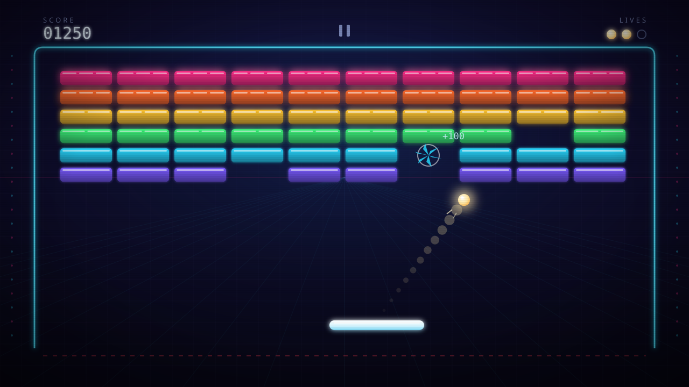

# 美术指导文档（ART_DIRECTION）——打砖块

- 文档名：美术指导文档（ART_DIRECTION）
- 版本：v0.1（作者批次 2/5 初稿）
- 作者：美术指导 owner
- 日期：2026-10-01
- 文档语言：中文
- 上游依据：`docs/GDD.md` v0.1（单关卡、固定矩形砖块阵列、普通砖块一击即碎、挡板、球、三生命、开始/HUD/暂停/过关/失败、仅横屏）

> 本文档只给视觉方向与一致性规则，不规定资产的生产路线（生成 / 库选 / 程序化绘制均可），不定义最终几何，不出资产清单。

---

## 1. 焦点母题与情绪

### 1.1 选定方向：深夜机房里一台亮着灯的机柜"发光弹球台"

玩家不是在看一块抽象运动场，而是站在一台深夜仍亮着灯的街机机柜前：整个房间是暗的，只有台面在发光——冷青色的灯轨框出台面，砖块是一排背光彩釉亚克力，球是唯一的白炽光源。

**母题一句话：暗房里的发光台面，和台上那颗暖白色的灯泡球。**

"弹球台感"只取情绪与视觉装置（灯轨、灯箱、计分转轮般的数字、台面在暗房中发光），**不借用弹珠台的任何机构**：画面中不得出现弹珠台挡板（flipper）、缓冲器（bumper）、弹簧杆等可能被误读为新玩法物体的图形。GDD 排除的道具、特殊砖块同样禁止以装饰形式出现。

### 1.2 情绪如何落成可执行规则

| 情绪意图 | 执行规则 |
|---|---|
| 暗房、聚焦 | 屏幕平均明度压低；亮只给球、挡板、砖块、UI 四类，其余一切压进暗部 |
| 霓虹、机柜 | 所有发光体使用"加色 / 滤色（screen / additive）"外发光；发光边界收得紧，不做大面积光晕糊开 |
| 弹球台、计分 | 数字使用等宽街机计字风格；HUD 像机柜上的计分转轮一样常驻、冷静、不抢球 |
| 一击即碎的爽快感 | 击碎反馈短促、明亮、有碎屑；所有特效都在 250ms 内结束，不拖沓 |

### 1.3 开始界面：标题主体与安静区

- **标题主体（title subject）：一个横向霓虹灯箱招牌（cabinet marquee）。**
  - 位于屏幕上部约 12%–32% 高度区域，水平居中；灯箱为深色底 + 青色外框光，标题文字做**灯管字**处理（字的笔画即发光管，笔画末端为圆头封口，沿字外缘有紧贴的霓虹光）。
  - 灯箱下沿嵌一条迷你"砖块灯带"：6 段小色块，颜色与第 4 节砖块行色一一对应，是灯箱装饰而不是可玩物。
  - 灯箱右侧停留一颗**大号暖白球 + 短拖尾**，呈"即将弹出"的定格（球比场内地中的球更大、更亮，是开始界面的第二视觉点）。
- **安静区（留白）：屏幕纵向约 40%–78% 的中央区域。**
  - 此区域只允许极暗网格（明度不超过背景 10%）、居中的"开始游戏"主按钮及其下方一行操作小字；不放任何插画、灯带或装饰。
  - 这块暗场在构图上预先扮演"空台面"，玩家点击开始后视觉无须重新找焦点。
- 游戏名称的**具体文字内容**由 UI / 文案提供，美术只锁定灯箱结构与灯管字处理。

---

## 2. 形状语言

- **基本族：圆角矩形。** 所有人工物（砖块、按钮、面板、灯箱）共享同一组圆角比例，靠尺寸、色值和发光强度分工，不靠风格混搭。
- **球是全场唯一的纯圆形主角**；任何装饰不得出现与球等大、同暖白色的正圆，避免"多球"误读。
- **挡板为横向胶囊形**（圆角半径 = 高度的一半），与砖块的小圆角形成明确层级：砖块是台面镶嵌物，挡板是独立握在玩家手里的器具。
- 剪影对比优先级：球（圆）→ 挡板（长胶囊）→ 砖块（小圆角矩形阵列）→ 边界（线框）→ 背景（无限重复网格）。角色对立主要靠轮廓与明度，不靠颜色。
- 不使用锐角、尖刺、有机曲线或手绘抖动线条；直线端点一律硬切或圆头（灯管为圆头，结构边为硬切）。

---

## 3. 调色板（具体色值）

参考画布为 1280×720 设计像素；色值在设计坐标系间等比换算，不随宿主设备像素改变。

### 3.1 背景与暗部

| 用途 | 色值 |
|---|---|
| 背景最深处（底部 / 四角） | `#060512` |
| 背景基色 | `#0C0A20` |
| 背景上部（灯箱环境光方向） | `#0E0A28` |
| 网格线 | `#2E3C7E`（不透明度 7%–14%） |
| 背景中远光 | `#2360B8`（径向，峰值不透明度 28%） |
| HUD/界面次要文字 | `#7B88B8` |
| HUD/界面主要文字 | `#E8F4FF` |

### 3.2 砖块行色阶（自上而下 6 行）

| 行 | 色值 | 名称 | 视觉档位（tier） |
|---|---|---|---|
| 第 1 行 | `#FF2E88` | 霓虹品红 | T1 强发光 |
| 第 2 行 | `#FF6A2B` | 霓虹橙 | T1 强发光 |
| 第 3 行 | `#FFC531` | 琥珀黄 | T2 中发光 |
| 第 4 行 | `#3DF57A` | 霓虹绿 | T2 中发光 |
| 第 5 行 | `#27D8FF` | 霓虹青 | T3 弱发光 |
| 第 6 行 | `#7A5BFF` | 霓虹紫 | T3 弱发光 |

- 色阶顺序在所有画面、UI 示意图、装饰灯带中**永远一致**（品红→橙→黄→绿→青→紫）。
- **tier 仅是视觉档位（发光强度 + 高光分段），不代表血量或行为**：全部砖块仍为一击即碎。
- 若平衡文档最终决定颜色行不对应分值，行色阶作为节奏装饰保留；若对应不同分值，tier 不要求与分值一一对应，分值信息的承载方式见第 9 节。

### 3.3 交互物主色

| 用途 | 色值 |
|---|---|
| 球芯 | `#FFFDF5` |
| 球光晕 | `#FFE9A8` / 边缘 `#FFB548`（暖白，刻意区别于冷色台面） |
| 挡板顶面 | `#FFFFFF` |
| 挡板主体 | `#D8F6FF` → `#7FD8F5`（垂直渐变） |
| 挡板发光 | `#36E2FF` |

### 3.4 强调色与语义保留色

| 用途 | 色值 | 规则 |
|---|---|---|
| 主强调（边界、主按钮、焦点） | `#2DE2FF` | UI 与场地共用的唯一主强调 |
| 次强调（开始界面灯箱、氛围线） | `#FF2E88` | 与第 1 行砖共用色相，不用于危险语义 |
| 危险 / 失误 | `#FF3B4D` | **保留色**：仅用于失误、底部危险虚线；出现时必伴随形状（断线 / 空心态）或运动（屏震），永不单独承担信息 |

### 3.5 明度对比目标

- 背景明度约 3%–5%；球芯约 98%、挡板约 90%：球、挡板对背景明度比目标 **≥ 7:1**，任何特效叠加上后不得低于 4.5:1。
- 砖块本体明度落在约 50%–82%：对背景 **≥ 3:1**，但整体压在球与挡板之下，不与其争最亮。
- HUD 主要文字对背景 **≥ 7:1**，次要文字 ≥ 3:1。
- 检查要求：关键信息（球、挡板、发球提示、生命、按钮焦点）在去色（灰度）视图下必须仍可辨认；颜色只做分组与情绪。

---

## 4. 材质感与细节密度

| 对象 | 材质 | 细节上限 |
|---|---|---|
| 砖块 | 背光彩釉亚克力：实色体 + 顶部受光高光 + 底部内阴影 + 紧贴外发光 | 每块最多 4 个细节层（本色、底阴影、顶高光、外发光） |
| 挡板 | 磨砂白亚克力条，内嵌青色光管，边缘透出冷光 | 本体渐变 + 顶部一条高光 + 外发光 |
| 球 | 白炽灯泡珠：暖白实芯，左上一个小高光点，外圈暖光晕 | 实芯 + 高光点 + 光晕，共 3 层 |
| 边界 | 青色霓虹灯管：管体亮线 + 内白芯 + 外发光 | 3 层 |
| 背景 | 机房暗墙：正交网格 + 向中心汇聚的淡透视线 + 中远光 | 低密度、重复、无手绘纹理 |

- 全场统一叠一层极轻的扫描线（深色线，不透明度约 6%）作为机柜屏幕质感，只做统一气氛，不参与信息传达。
- 不做拟真磨损、锈蚀、指纹、木纹等写实质感；"做旧"最多表现为装饰灯亮度轻微不均。
- 细节密度原则：**越靠中心 / 越可交互，细节越实；越靠外围 / 越远，细节越省**。背景元素明度不得超过暗部上 15%，饱和度可以高但面积必须小。

---

## 5. 字体性格（不指定版权字体文件）

### 5.1 中文标题字形方向

- **几何方块黑体**：字面方正、笔画接近等粗、笔画端点硬切、无喇叭口、无书法笔锋；字重 Heavy / Black，字距略宽（约 1.5%–3% 字宽）。
- 在开始界面标题上做灯管字二次处理：沿笔画给圆头发光与紧贴外光；其余界面中文（暂停、结算、按钮）用同族中等字重，不做灯管处理。
- 禁用：书法体、圆体、衬线体、纤细科技体。

### 5.2 数字与 HUD 字体方向

- **等宽几何街机计字**：数字为等宽（tabular）、方形 / 微圆角轮廓、x 字高偏大，气质接近机柜计分转轮与 LED 计分牌，但必须保证现代浏览器小字号下的可读性（不使用残缺断肢字形做正文数字）。
- 分数、击碎浮字、结算分数统一该方向；"SCORE / LIVES"等标签用中文几何黑体或小号宽字距大写方向，与数字同族搭配。
- 具体字库选型与授权由资产计划决定；本文档只锁定字形性格。

---

## 6. 运动与特效气质

总原则：短、亮、脆。全部反馈为一次性脉冲，不做循环闪烁（发球提示的呼吸除外）。

- **球拖尾**：加色暖光，沿运动方向做 3–5 段渐隐的收尖光带（或一串渐缩渐隐的残影），长度随当前球速缩放；球与挡板 / 砖块碰撞瞬间，拖尾在撞击点短促亮一下即收。
- **砖块碎裂**：总时长 180–240ms。击中瞬间先有 1–2 帧白热闪（60fps 下），随后生成 4–6 片尖角碎块，颜色取自该砖行色，向外抛射、带轻微下坠并快速淡出；撞击点同时有一个快速扩张的细白光环。无烟、无 dust、无长残留。
- **挡板挤压反馈**：球击中挡板时，挡板在约 120ms 内完成"纵向压缩约 15% 并轻微加宽 → ease-out 回弹"，顶边高光同时亮一下；移动过程中不做倾斜，保持横向稳定。
- **过场节奏**：失误反馈 300ms 内收完；暂停进出 150–200ms；过关 / 失败的光效可以长到 0.8–1.2s，但玩家可操作按钮在光效中即应可点（按钮行为以 UI 文档为准）。

---

## 7. 同一视觉语言下的层级分工

所有对象共用圆角矩形族、垂直上亮下暗渐变、紧贴式加色发光；层级差异通过**明度、尺寸、发光强度、轮廓**四个杠杆拉开。

| 层级 | 对象 | 处理 |
|---|---|---|
| 1 主角焦点 | **球** | 全场最高明度（暖白近 100%）、最强外发光、唯一暖色温、带拖尾；任何时刻都是第一眼落点 |
| 2 玩家化身 | **挡板** | 冷白高对比、胶囊轮廓、中等发光；击球点永远是台面第二亮处 |
| 3 台面目标 | **砖块** | 行色 + tier 发光；行差异必须三轨并行：色相、明度/底阴影、顶部高光分段（T1 分 3 段、T2 分 2 段、T3 为 1 整段），不允许只靠颜色区分行 |
| 4 场地结构 | **边界** | 青色霓虹 U 形管（左 / 上 / 右三面），亮度低于挡板；**底部不封边**，仅一条红色虚线危险提示——"开口"本身靠形状表达，颜色只作辅助 |
| 5 环境装饰 | 网格、透视线、侧边小灯点、中远光 | 压暗、小面积、可无限重复；不与任何可交互物抢轮廓 |
| 6 信息层 | HUD / 菜单 | 与世界同语言（同圆角、同青色强调、同发光语法），但主要文字明度接近挡板而面积小，且固定在场地外的顶带，不压球的飞行区 |

---

## 8. 重要状态变化的视觉区分

| 状态 | 视觉规则 |
|---|---|
| **发球准备（Ready）** | 球静止附着在挡板顶面中央上方，球与挡板之间有一小块贴合光垫；"发球"提示做 1.2s 周期的呼吸（不透明度 0.55↔1、缩放 0.97↔1.03，ease-in-out），是全场唯一被允许的循环呼吸动画；移动挡板时球随之摆位 |
| **游玩中（Playing）** | 台面全亮：拖尾、外发光、碎裂全部生效；HUD 常驻；不播放任何与事件无关的动画 |
| **已暂停（Paused）** | 全局冻结（含拖尾、碎块、发光动画全部定格）；叠压暗遮罩 `#060512` 不透明度 55%–60%，并轻微去饱和；"已暂停"与菜单按钮居中出现在遮罩之上 |
| **失误（Miss）** | 克制的一次性反馈：屏幕边缘 / 暗角做一次约 260ms 的红色脉冲；屏震为单次衰减、约 300ms、振幅不超过设计高度的 0.8%；球向底部暗去消失。不做连续红闪、不做大红屏 |
| **过关（LevelClear）** | 明亮绽放：最后一块砖碎裂的光环后，0.5s 内整体提亮，暖白金径向光从最后碎点绽放（峰值叠加白约 50% 不透明度），可有少量同色火花粒子，随后稳定在比常态亮一档的结算画面 |
| **失败（GameOver）** | 暗下：0.8–1.2s 内暗角向内收拢、饱和被抽除，冷青发光逐档变暗，仅保留结算文字与按钮所需的最低对比；安静、缓慢，与过关形成明暗对仗 |

### 剩余生命的视觉表示

- 以**小球形图标（pip）**表示，直径约为 HUD 数字行高的 1.1 倍：
  - 仍存活：实心暖白球（与球同材质、带发光）；
  - 已失去：同一位置变为**空心暗环**（描边约 2px、`#4A5480`、无发光、内部微暗）。
- 失去生命时图标**原地换形不移除、不重排**；形状（实心 vs 空心环）是主载体，色相变化只是辅助。HUD 是否同时显示数字（如 `×2`）由 UI 文档决定，美术方向兼容。

---

## 9. 分层、独立层与横屏适配

画面由三个独立层 + 一个叠加层构成，各自可独立替换 / 绘制：

| 层 | 内容 | 不透明度 / 处理 | 独立层与平铺要求 |
|---|---|---|---|
| L1 前景 HUD | 分数、生命 pip、暂停按钮 | 主文字 90%–95%、标签 60%–70%；小发光 | 独立层，固定在场地框之上的顶带；不随任何运动位移 |
| L2 场地主体 | 砖块、挡板、球、拖尾、碎块、边界 | 不透明主体 + 加色光 | 边界框与场地物可独立成组；碎块 / 拖尾等瞬态元素建议放在独立的加色叠加层，便于开关与降级 |
| L3 背景 | 暗墙渐变、正交网格、透视汇聚线、中远光、侧边灯点 | 网格 7%–14%、远光峰值 28%、边灯 30% | **全屏出血的独立层**：网格以约 40 设计像素为周期，可向两侧无限平铺；中远光为居中径向，不依赖任何角落图案 |
| 叠加层 | 暂停压暗、失误红脉冲、扫描线、暗角 | 见第 6、8 节 | 独立全屏层，可整体关闭（如低端降级或无障碍高对比模式） |

### 横屏宽高比构图规则（不留破綻）

1. **中心构图**：中远光、透视消失点、灯箱、台面全部以水平中线对称布置；关键装饰距左右安全边不少于屏宽 12%。
2. **可扩展带**：屏幕左右各约 12%–15% 只放纯暗部 + 周期网格 + 侧边灯点，宽高比变宽时只延长该带，不拉伸、不裁切关键图形。
3. 背景不使用位图角花或与分辨率绑定的插画；若使用位图背景，必须配套同周期可平铺边缘或两侧暗部遮罩。
4. 可选的轻微视差：背景网格随挡板横移做不超过屏宽 2% 的反向位移；HUD 与场地几何不参与视差。

---

## 10. 显示尺度考量

- 最小可用设计尺寸由 UI/UX 文档定义（本文档不预设）；以下为对任何尺度都成立的规则：
  - 砖块在最小尺寸下必须保持三要素可辨：**本色体、顶部亮边、砖块间深色间隙**；砖间间隙渲染后不得小于 1 设备像素。
  - 缩小时允许的简化顺序：先合并高光分段为一条整亮边 → 再关闭外发光；底阴影可并入本体深色。**不允许**先牺牲间隙与轮廓。
  - 碎裂在最小尺度下仍要可辨：碎块不少于 3 片；若单片渲染不足 2px，则放弃碎块、改为一次白闪 + 光环表达同一事件。
  - 球渲染直径目标不小于 8 设备像素，拖尾在最小尺度下至少保留 2 段渐隐；最终数值随 UI 文档的最小可用尺寸复核。

---

## 11. 一致性准则（生成 / 库选 / 程序化通用）

以下规则对素材生成提示词、库选验收、程序化绘制**同等有效**；任何路线产出的资产都必须能回到同一套参数。数值以 1280×720 参考画布的设计像素表述。

- 圆角半径：砖块 `6`；UI 按钮 / 面板 `8`；灯箱与场地外框 `12`；挡板 `= 高度 / 2`（胶囊）。
- 描边：物体本体不加外描边，以"顶部内高光 + 底部内阴影"塑形——高光白色不透明度 55%（约 1–3px）、底阴影为 `#060512` 不透明度 45%；边界框 3px `#2DE2FF` + 1px 内白芯（35%）。
- 发光：一律加色 / 滤色，收紧贴边。标准档位（模糊半径 / 不透明度）：弱 `4 / 25%`、中 `8 / 40%`、强 `12 / 60%`；球 `16 / 70%`；挡板 `10 / 45%`；UI 文字 `6 / 50%`。
- 渐变方向：物体本体一律 **180° 垂直、上亮下暗**（亮端混入约 20%–30% 白，暗端混入 40%–50% `#060512`）；背景光一律**居中径向**；禁止斜向、径向混用在物体本体上。
- 色板：仅可使用第 3 节色值；需要衍生时，保持色相不变、只在规定明度 / 不透明度档位内变化。
- 库选素材必须与上述规则做风格匹配（允许统一调色与边角修整），来源与授权由资产计划核验；风格不兼容的素材即使单独质量再高也不入选。

---

## 12. 代表性概念图

下图为**代表性完整玩家视角概念图**（游玩中瞬间）：传达三层关系、发光材质与暗房情绪，可见砖块行色阶与高光分段、球的暖白拖尾、挡板胶囊外形、U 形青色边界、底部红色虚线危险口、HUD 计分与生命 pip（含一个"已失去"空心环），以及一处正在发生的碎裂与分值浮字。

- 文件：`docs/concept/breakout_concept.svg`（程序化 SVG，常见浏览器可直接打开）。
- 性质声明：此图是**概念表达，不是最终资源交付，不证明最终运行时效果与性能**；本批次未做运行时 / 浏览器视觉核验，最终观感留待资源交付与运行时验收。

---

## 13. 边界声明

- 最终几何（砖块 / 挡板 / 球的尺寸、阵列行列、边距、HUD 与按钮的布局与坐标）留给 **UI_UX_SPEC** 及场景 / UI JSON，本文档不做最终矩形。
- 资产清单（需要哪些素材、各自格式、生产路线、来源授权）留给 **ASSET_PLAN**，本文档不预设库存，也不指定每件资产由生成、库选还是程序化产出。

## 14. 依赖与未决项

- **颜色行是否对应不同分值**：由数值平衡文档决定。
  - 若对应分值：分值信息以击碎瞬间的**分值浮字**与 HUD 分数变化承载，颜色行只做情绪与节奏分组，不承担准确读数。
  - 若全部同值：行色阶与 tier 作为纯视觉节奏保留，规则不变。
- **最小可用设计尺寸**：由 UI/UX 文档定义；第 10 节的尺度规则在其数值确定后复核。
- 标题文字内容：由 UI / 文案提供。
- 与 UI 文档的衔接点：HUD 布局、暂停 / 结算面板的具体位置、按钮焦点形态由 UI 文档落位，美术提供第 3、11 节的视觉参数。
