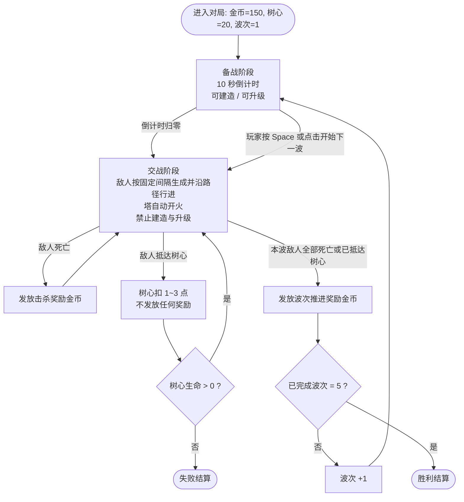
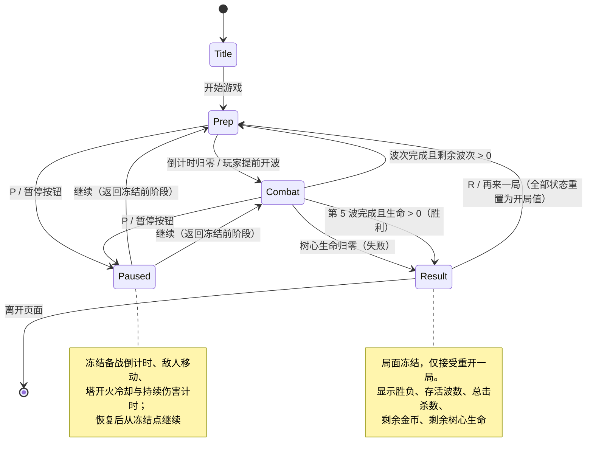

# 森林孢子守卫（Spore Guard）游戏设计文档

<!-- beegame-executive-summary -->
## Executive Summary

本文档是《森林孢子守卫》的玩法权威决策记录。游戏为单人、俯视角、2D、PC 网页塔防，玩家在固定森林地图上布置并升级蘑菇塔，抵御 5 波萤火虫，保护树心。

权威索引：

| 主题 | 权威位置 |
| --- | --- |
| 产品承诺、范围与非目标 | 本文 Vision and Product Promise |
| 体验支柱 | 本文 Player Experience and Design Pillars |
| 循环进入/退出/奖励转移 | 本文 Production Materials → Core Loop Diagram |
| 玩家动作与操作标签 | 本文 Player Actions and Controls |
| 实体、机制与规则优先级 | 本文 Gameplay Rules and Systems |
| 状态机与恢复路径 | 本文 Production Materials → Game State Flow |
| 具体数值、公式、波表、成本曲线 | docs/BALANCE_DESIGN.md |
| 地图几何、路径点、建造点坐标 | docs/LEVEL_SCENE_DESIGN.md |
| 运行时架构、React 实现与帧循环 | docs/TECHNICAL_DESIGN.md |
| 界面布局、控件、反馈时序 | docs/UI_UX_SPEC.md |
| 占位视觉规范 | docs/ART_DIRECTION.md |
| 音频事件 | docs/AUDIO_DESIGN.md |
| 资源清单与占位来源 | docs/ASSET_PLAN.md |

本文中的所有难度与容错表述均为设计目标，尚未经过可玩测试验证。

<!-- beegame-section:vision -->
## Vision and Product Promise

**承诺**：在 10 分钟内完成一局完整、可读、有明确胜负的森林塔防。玩家的每一次放塔与升级选择都能在下一波立刻看到后果。

**目标受众**：能用键鼠操作网页游戏的休闲策略玩家，包含塔防新手；不要求预先了解塔防术语。

**核心价值**：极短的学习成本 + 固定地图带来的可掌握感。因为地图、路线、波表都固定，玩家第二局就能基于第一局的失败做出针对性布防，这是本作唯一的重玩动机。

**范围**（与已确认 Brief 一致）：
- 一张固定森林地图、单一敌人路线、固定可建造地块
- 3 种塔，每种可升级两级（共 3 级）
- 2 种敌人
- 5 波固定波次配置
- 金币经济（开局 150 金币，击杀获得金币）
- 树心 20 点生命，漏怪扣 1～3 点
- 胜负结算界面，显示存活波数与击杀统计
- 全部使用占位色块与图形资源

**非目标**（明确不做，不因后续讨论隐式引入）：
- 拆塔与退款
- 分支路线、多地图、随机地图
- 主动技能、法术、英雄单位
- 多人、联网、排行榜、账号
- 付费、内购、广告
- 存档与跨会话进度（每次刷新页面从头开始）
- 移动端与触屏适配（PC 网页鼠标键盘唯一目标）

<!-- beegame-section:experience_pillars -->
## Player Experience and Design Pillars

**目标情绪**：从"看着路线思考"到"看着孢子飞出去命中"的短周期满足感；以及第 4、5 波时"资源刚好够不够"的紧张感。

三条支柱及其保护性决策：

**支柱一：一眼看懂**。任何时刻玩家不需要阅读文字就能判断局势。保护决策：可建造地块永久可见（不靠悬停才出现）；塔的攻击范围在选中和放置预览时以圆形轮廓显示；敌人血条常显；树心生命与金币始终在 HUD 固定位置。占位资源阶段以颜色区分实体类别而非细节造型，规范见 docs/ART_DIRECTION.md。

**支柱二：决策后果立即可见**。保护决策：波次之间有 10 秒备战期，且波间不自动开始——玩家可主动提前开波（见 Player Actions and Controls），使"我改了布防→我马上验证"的间隔最小化。升级效果（伤害、射程）在升级前以预览数值和范围圈呈现，避免盲目消费。

**支柱三：混搭优于堆叠**。光甲萤火虫对单体伤害有抗性，使纯速射孢子塔或纯重击伞菌塔阵型在含光甲的波次中吃力，从而把"选哪种塔"变成真实决策而非唯一最优解。抗性机制的规则归属见 Gameplay Rules and Systems，具体系数归 docs/BALANCE_DESIGN.md。这是设计目标；单一塔型能否通关需实测确认，本文不作保证。

**主动放弃的体验**：不提供教学关卡。首波以低压力波次承担教学职责（第 1 波仅普通萤火虫、数量少），配合 HUD 常显的塔卡片信息，避免额外流程。代价是玩家可能在第 1 波浪费金币，这被接受，因为第 1 波掉血不足以致败。

<!-- beegame-section:core_loop -->
## Core and Session Loops

**会话结构**：单局即会话。进入游戏 → 布防/开波循环 5 次 → 结算 → 可重开新局。无跨局进度。

**核心循环的含义**：循环由"备战"和"交战"两个阶段交替构成。备战阶段是玩家唯一的决策窗口（放塔、升级）；交战阶段玩家只观察与获得金币，不能建造或升级——这条限制让每次决策都必须在信息不完整时做出，是本作的策略压力来源。

**节奏意图**：单局目标时长 6～10 分钟。备战期固定 10 秒，用于保证玩家来得及花掉刚获得的金币；交战期长度由波次敌人数量与行进时间决定，归 docs/BALANCE_DESIGN.md。允许提前开波是节奏的主要调节手段：熟练玩家可压缩总时长，新手可用满 10 秒。

**玩家可感知的后果**：金币只能通过击杀与波次推进获得，且不可通过拆塔回收，因此每次消费都是不可逆的。漏怪的后果是树心掉血，不影响金币收入，所以"放弃拦截一只光甲以保住布局"是一个玩家可以主动做出的权衡。

循环的进入条件、退出条件与奖励发放时点以 Production Materials → Core Loop Diagram 为唯一记录。

<!-- beegame-section:player_actions -->
## Player Actions and Controls

以下标签为全项目玩家动作/机制的规范命名，其他文档引用这些标签。

| 动作标签 | 输入（鼠标） | 输入（键盘） | 目标选取 | 约束 |
| --- | --- | --- | --- | --- |
| 选择塔类型 | 左键点击 HUD 塔卡片 | `1` / `2` / `3` | 无 | 金币不足时卡片置灰，仍可选中以查看信息但不能确认建造 |
| 建造塔 | 在高亮空建造点左键点击 | 选中类型后 `Enter` 于键盘光标位置确认 | 单个建造点 | 仅备战阶段；该点必须为空；金币≥造价 |
| 取消选择 | 右键 / 点击空白处 | `Esc` | 无 | 任意阶段可用 |
| 选中已建塔 | 左键点击塔 | `Tab` 在已建塔间循环 | 单座塔 | 任意阶段可用（交战阶段仅查看） |
| 升级塔 | 选中后点击升级按钮 | `U` | 当前选中塔 | 仅备战阶段；塔等级<3；金币≥升级费 |
| 开始下一波 | 点击"开始下一波"按钮 | `Space` | 无 | 仅备战阶段；立即结束剩余备战倒计时 |
| 暂停/继续 | 点击暂停按钮 | `P` | 无 | 交战与备战阶段均可用；结算界面不可用 |
| 重开一局 | 点击结算界面"再来一局" | `R` | 无 | 仅结算界面 |
| 移动键盘光标 | — | 方向键 | 在建造点之间跳转 | 键盘可达性用，见 Accessibility and Localization Intent |

**目标与交互意图**：建造是"选类型 → 选位置"两步，因为固定建造点数量有限，两步流程能在第一步就用高亮告诉玩家哪些位置可用，减少无效点击。升级是"选塔 → 确认"两步，因为升级不可逆且消耗金币，需要一次确认。塔的攻击目标由系统自动选取，玩家不能手动指定目标——这是有意的简化，使玩家注意力留在布局决策上。

**不绑定引擎**：以上仅定义输入语义与约束。事件监听、焦点管理与帧内处理顺序由 docs/TECHNICAL_DESIGN.md 决定；控件外观、位置与状态反馈由 docs/UI_UX_SPEC.md 决定。

<!-- beegame-section:rules_systems -->
## Gameplay Rules and Systems

### 实体

**树心**：地图中央的防守目标，20 点生命，不可移动、不可升级、不参与战斗。生命归零触发失败。

**敌人：普通萤火虫**。血量低、速度中等，沿固定路线单向行进，不攻击塔，抵达树心时消失并造成掉血。

**敌人：光甲萤火虫**。血量高、速度慢，对单体伤害有抗性（伤害按抗性系数减免）。其余行为同普通萤火虫。

**塔：速射孢子塔**。单体、低伤害、高攻击频率。抗性对其影响最大，是对付普通萤火虫的主力。

**塔：毒雾塔**。范围效果，施加减速与持续伤害。持续伤害不属于单体伤害，不受光甲抗性减免——这是"混搭优于堆叠"支柱的机制支点。

**塔：重击伞菌塔**。单体、高伤害、低攻击频率。对光甲的单发效率高但受抗性减免，需与毒雾塔配合。

### 规则

**建造规则**：塔只能建在预置建造点上，一点一塔。建造点集合与坐标由 docs/LEVEL_SCENE_DESIGN.md 定义。建造后不可拆除、不可移动、不可更换类型。

**升级规则**：每座塔从 1 级可升至 3 级（两次升级）。升级提升伤害与射程，不改变塔的类型与效果种类（速射塔升级后仍是单体，毒雾塔升级后仍是范围减速+持续伤害）。升级费用与数值曲线归 docs/BALANCE_DESIGN.md。

**攻击规则**：塔在射程内自动选取目标并按自身攻速开火。目标选取规则统一为"射程内沿路径推进最远的敌人"，保证玩家能从塔的位置预测其行为。

**减速与持续伤害叠加规则**：同一敌人被多座毒雾塔覆盖时，减速取最强的一份、不叠加（避免多塔堆叠使敌人接近静止）；持续伤害按来源独立累加。此优先级为规则决策，具体数值归 docs/BALANCE_DESIGN.md。

**伤害类型与抗性优先级**：抗性只减免单体伤害。结算顺序为：先按伤害类型判定是否适用抗性 → 再扣减血量。血量≤0 时敌人死亡并立即结算金币。

**漏怪规则**：敌人抵达树心时按其类型造成 1～3 点生命损失，损失量属于敌人属性，归 docs/BALANCE_DESIGN.md。漏怪不返还金币、不影响击杀统计。

**金币规则**：开局 150 金币。收入来源为击杀奖励与波次推进奖励。金币无上限，不随波次衰减，无利息机制。支出仅有建造与升级两项。无退款路径。

**波次规则**：5 波固定编成，顺序、数量、敌人组合固定且每局相同。波内敌人按固定间隔从入口生成。波次判定为"该波所有敌人已死亡或已抵达树心"。

**规则优先级**：当规则冲突时，按以下顺序裁定——① 树心生命归零立即失败，优先于任何未结算的击杀奖励；② 阶段限制（交战阶段禁止建造/升级）优先于金币充足；③ 金币不足优先于任何操作确认。

阶段与波次的转移记录见 Production Materials → Core Loop Diagram；局面状态转移见 Game State Flow。

<!-- beegame-section:states_flow -->
## Game States and Flow

**状态归属**：单局共 5 个玩家可感知状态——标题（Title）、备战（Prep）、交战（Combat）、暂停（Paused）、结算（Result）。状态由玩法层单一持有，UI 只读取显示，不得自行推导阶段。

**不变量**：
- 建造与升级操作仅在 Prep 状态被接受；其他状态下相应输入被忽略并给出禁用反馈（反馈形式归 docs/UI_UX_SPEC.md）。
- Paused 状态下所有计时与运动冻结，包括备战倒计时、敌人移动、塔开火冷却与持续伤害计时；恢复后从冻结点继续，不补偿也不跳帧。
- 树心生命只减不增；金币在同一局内单调受控于建造/升级支出与击杀/波次收入。
- 进入 Result 后局面冻结，仅接受"重开一局"。

**恢复后果**：本作无存档。刷新或关闭页面等同放弃本局，重新进入从 Title 开始，金币、塔、生命、击杀统计全部重置。这是明确接受的代价，换取无持久化层的实现范围。运行时若发生不可恢复错误，处理策略归 docs/TECHNICAL_DESIGN.md。

**结算内容**：Result 显示胜负、存活波数（胜利时为 5）、总击杀数、剩余金币、剩余树心生命。

规范状态转移、暂停、完成、失败与恢复路径以 Production Materials → Game State Flow 为唯一记录。

<!-- beegame-section:progression -->
## Progression, Rewards and Economy Boundary

**解锁**：无解锁系统。三种塔从开局即全部可用。理由：5 波的单局长度不足以支撑逐步解锁的教学价值，且解锁会削弱第一局的布防决策空间。

**局内成长节奏**：玩家的成长完全体现为"塔的数量 × 塔的等级"。设计意图的推进节奏为——第 1～2 波以铺开塔数量为主，第 3 波起因造价与升级费的相对关系转向升级少数关键塔。该节奏由造价/升级费/击杀收益三者关系产生，是设计目标，具体数值与验证归 docs/BALANCE_DESIGN.md。

**奖励**：两类。击杀奖励在敌人死亡瞬间发放；波次推进奖励在波次判定完成时发放。漏怪不产生任何奖励。奖励发放时点见 Core Loop Diagram。

**跨局进度**：无。无成就、无解锁、无难度选择。重玩动机来自固定地图的策略优化（见 Vision and Product Promise）。

**经济职责边界**：GDD 定义经济的结构——收入渠道、支出渠道、无退款、无利息、起始金币为 150、升级层数为 2。所有具体数字（各塔造价、各级升级费、各敌人击杀奖励、各波推进奖励、总收入包络）由 docs/BALANCE_DESIGN.md 拥有并负责可达性验证。GDD 不复述这些数字，也不预先断言某种消费策略必然通关。

<!-- beegame-section:content_narrative -->
## Content and Narrative Framework

**主题与设定**：温和的森林真菌世界。玩家一方是共生的蘑菇群落，通过喷射孢子、释放毒雾驱赶入侵的萤火虫，保护森林中央的树心。基调为无血腥、无死亡描写的柔和奇幻。

**叙事适用范围**：无剧情、无对话、无过场、无角色。叙事仅通过命名与视觉主题承载（塔名、敌人名、树心）。理由：单局 5 波的体量无法承载叙事，任何过场都会与"决策后果立即可见"支柱冲突。

**内容分类**：全部内容为玩法内容，分为 5 类——地图（1 张）、建造点、塔（3 种 × 3 级）、敌人（2 种）、波次（5 波）。数量边界即为 Vision 中的范围列表。

**文本内容**：仅界面文本与实体名称，语言为简体中文，见 Accessibility and Localization Intent。

**内容边界**：不加入 boss、精英怪、天气、昼夜、随机事件、环境交互物。地图上的装饰元素为纯视觉，不影响路径或射程，归 docs/ART_DIRECTION.md 与 docs/LEVEL_SCENE_DESIGN.md。

<!-- beegame-section:challenge_recovery -->
## Challenge, Failure and Recovery

**挑战来源**（三项，均为结构性而非随机）：
1. **资源稀缺**：起始 150 金币不足以覆盖所有建造点，玩家必须选择优先位置。
2. **敌人构成变化**：光甲萤火虫在后段波次出现，使前段有效的纯单体阵型效率下降，迫使玩家在中段就为抗性做准备。
3. **不可逆消费**：无退款意味着错误布防无法回收，只能靠后续收入弥补。

**公平性要求**：
- 波次编成固定且每局相同，无随机数影响难度——玩家的失败必定可归因于自身决策，这是本作公平性的基础。
- 每波开始前，玩家必须能看到该波的敌人构成预告（形式归 docs/UI_UX_SPEC.md），使"为抗性做准备"成为知情决策而非试错惩罚。
- 塔的射程在选中时可见，玩家不需要靠观察开火来推断覆盖范围。
- 20 点树心生命与 1～3 点的漏怪损失，意味着单次漏怪不会直接致败，允许玩家犯错后修正。具体容错波数取决于波次编成，由 docs/BALANCE_DESIGN.md 计算与验证；本文不给出未经计算的容错承诺。

**反制期望**：每一波都存在至少一种玩家可用的应对手段——面对高数量普通萤火虫用速射塔与毒雾塔的减速拉长受击时间；面对光甲用毒雾塔的持续伤害绕过抗性并配合重击伞菌塔。是否存在通用最优解需实测确认。

**失败与恢复**：失败仅由树心生命归零触发，无超时失败、无经济破产失败。局内没有复活、继续或救济机制；恢复手段只有重开一局。失败与恢复的状态转移见 Production Materials → Game State Flow。

<!-- beegame-section:accessibility_localization -->
## Accessibility and Localization Intent

**键盘可达性**：所有玩法动作均有键盘路径，与鼠标路径完全等价，见 Player Actions and Controls 的键盘列。方向键在建造点之间跳转配合 `Enter` 确认，使不使用鼠标的玩家可完成整局。键盘焦点必须始终有可见指示。

**无强制反应速度**：备战期不自动开波（10 秒倒计时结束后进入交战，但玩家可随时暂停），且 `P` 暂停在交战阶段可用，使运动能力受限的玩家有充足操作时间。无双击、无拖拽、无长按、无连点要求。

**视觉可达性**：实体区分不得仅依赖色相。塔类型、敌人类型、建造点可用性需同时具备形状或图案差异，具体规范归 docs/ART_DIRECTION.md。血条与生命值除颜色外须有数值或长度表达。

**音频可达性**：无任何仅靠音频传达的信息；音频为纯增强层，静音下可完整通关。音频事件归 docs/AUDIO_DESIGN.md。

**本地化边界**：本次仅交付简体中文（zh-CN）单语言。实现层要求 UI 文本集中管理、不硬编码进玩法逻辑，为后续接入其他语言留出接口，但本次不做语言切换 UI、不做多语言字体与文本长度适配测试。此为明确的范围取舍，代价是未来加语言时需重新做布局验证。

<!-- beegame-section:metrics -->
## Success Metrics and Analytics Intent

以下为设计目标，尚无观测数据。

| 指标 | 目标 | 含义 |
| --- | --- | --- |
| 单局时长 | 6～10 分钟 | 超出上限说明备战期或交战期节奏过慢，需调整波次生成间隔 |
| 首局通关率 | 30%～60% | 过高说明缺乏挑战，过低说明第 3 波的抗性转折缺乏预告或反制手段 |
| 三局内通关率 | ≥85% | 检验"固定地图带来可掌握感"这一核心价值是否成立 |
| 塔型使用分布 | 三种塔在通关局中均出现率 ≥50% | 检验"混搭优于堆叠"支柱；若某塔出现率过低则其定位失败 |
| 升级/建造支出比 | 通关局中升级支出占比 20%～50% | 检验升级是否为真实选项而非陷阱选择 |
| 平均剩余树心生命（通关局） | 5～15 | 过高说明难度不足，接近 0 说明容错过窄 |

**度量意图**：本次不接入任何遥测、不上报数据、不联网（见 Vision 非目标）。上述指标通过内部人工试玩记录采集，采集方式与判定归试玩执行环节；本文只定义指标含义与目标区间。指标口径变化需回到本节修改，不得在其他文档另立目标。

<!-- beegame-section:scope_risks -->
## Scope, Dependencies and Open Decisions

**生产范围**：Vision and Product Promise 中的范围列表即为生产范围，逐项可验收：1 张地图、固定建造点、3 塔 × 3 级、2 敌人、5 波、金币经济、5 状态流程、结算界面、全占位资源。

**依赖**：
- docs/LEVEL_SCENE_DESIGN.md 提供路径与建造点几何，是塔覆盖设计与波表设计的前置输入。
- docs/BALANCE_DESIGN.md 提供全部数值并负责通关可达性验证，是本文难度目标能否成立的唯一裁定方。
- docs/TECHNICAL_DESIGN.md 提供 React 运行时与帧循环方案，决定暂停冻结不变量能否被实现。
- docs/UI_UX_SPEC.md 提供波次预告、射程显示、禁用反馈的具体呈现，是"一眼看懂"与公平性要求的落地方。
- docs/ART_DIRECTION.md 与 docs/ASSET_PLAN.md 提供占位资源。占位资源的来源与许可状态由 docs/ASSET_PLAN.md 声明，本文不对其许可作任何已核验的断言。

**风险**：
1. **纯毒雾塔通吃**：若持续伤害绕过抗性的收益过高，玩家可能只造毒雾塔，直接击穿"混搭"支柱。缓解责任在 docs/BALANCE_DESIGN.md 的数值配置与试玩验证。
2. **固定波次导致重玩动机不足**：一旦通关，最优解固定，玩家无理由再玩。已接受——本次范围内不引入随机性作为解决方案。
3. **10 秒备战期不足**：新手可能来不及在 10 秒内完成选塔、选位、确认。缓解手段为交战阶段可暂停；若试玩显示仍不足，调整备战时长的决策权在本文本节。
4. **键盘路径实现成本被低估**：方向键在建造点间跳转需要合理的空间相邻关系定义，依赖 docs/LEVEL_SCENE_DESIGN.md 的点位布局配合。

**假设**：目标玩家使用带鼠标与键盘的桌面浏览器；单局无需存档；固定 5 波足以构成完整体验。

**未决事项**：
- 备战期是否允许"跳过并立即开波"之外的时长调整（当前决定：不允许，固定 10 秒 + 提前开波）——若风险 3 在试玩中成立，本节重新裁定。
- 波次预告的信息粒度（仅敌人类型 vs. 含数量）——决策权在本文，呈现权在 docs/UI_UX_SPEC.md；当前倾向包含类型与数量，待 UI 布局空间确认后定稿。

<!-- beegame-production-materials -->
## Production Materials

<!-- beegame-material:core-loop-diagram -->
### Core Loop Diagram

<!-- beegame-material:game-state-flow -->
### Game State Flow

