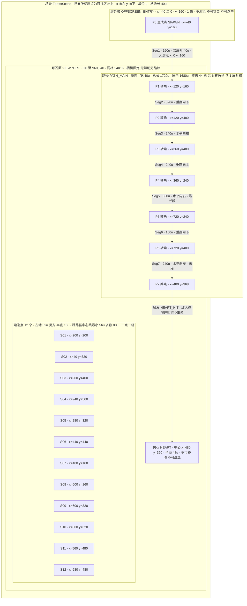
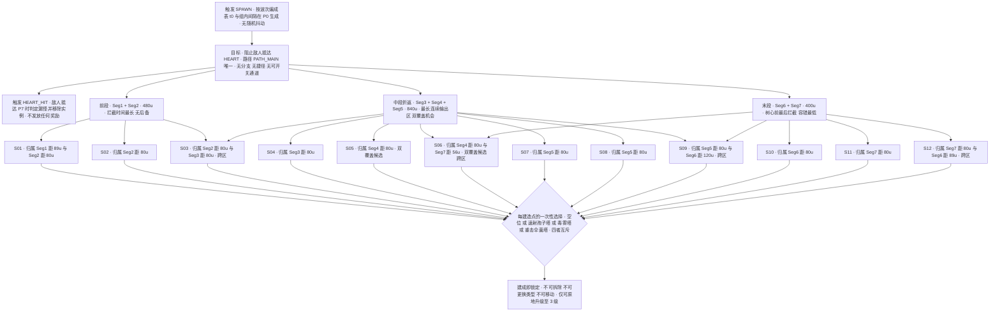

# 关卡与场景设计 · 森林树心防线

<!-- beegame-executive-summary -->
## Executive Summary

本文是本作空间与编成的唯一决策记录，拥有以下事实：

| 本文拥有 | 所在位置 |
| --- | --- |
| 世界坐标系、网格、路径航点与长度、树心位置、屏外带、触发区 | Production Materials → World Structure Diagram |
| 12 个建造点坐标、区段归属、战术角色、互斥规则映射 | Production Materials → Route and Choice Diagram |
| 节拍序列、时长、强度指数、恢复窗口 | Production Materials → Pacing Beat Table |
| 5 波完整编成（敌人类型、数量、生成组起始时刻与组内间隔） | Encounters and Challenge Placement |
| 场景复杂度预算与关卡侧验收检查 | Level Production and Acceptance |

本文不拥有：胜负规则、阶段限制、金币规则、抗性与叠加规则（docs/GDD.md）；敌人速度/血量/漏怪点数、塔造价与升级曲线、击杀与波次奖励（docs/BALANCE_DESIGN.md）；实体外观与颜色/形状区分规范（docs/ART_DIRECTION.md）；HUD 与波次预告的呈现形式（docs/UI_UX_SPEC.md）；帧内更新顺序与坐标到像素的映射实现（docs/TECHNICAL_DESIGN.md）；音频事件（docs/AUDIO_DESIGN.md）；占位资源清单（docs/ASSET_PLAN.md）。

本文向 docs/BALANCE_DESIGN.md 输出一条计算得出的约束：敌人屏内路程为 1680u，为使单局时长落入 docs/GDD.md 的 6～10 分钟目标区间，敌人移动速度须满足 v ≥ 28.5 u/s（推导见 Pacing and Gameplay Beats）。

<!-- beegame-section:world_structure -->
## World and Scene Structure

全部坐标、路径、网格、触发与屏外字面量由 World Structure Diagram 拥有，本节只记录层级与语义。

场景层级为单层：`ForestScene` 是本作唯一场景，内含四个逻辑集合——可视区网格、单条路径 `PATH_MAIN`、建造点集合、树心目标。不存在子场景、分区、流式加载或场景切换（后果见 Scene States and Transitions）。

坐标语义：世界坐标以可视区左上角为原点，x 向右、y 向下，单位记为 u。u 是逻辑单位而非像素；到屏幕像素的换算归 docs/TECHNICAL_DESIGN.md。网格仅用于对齐建造点与路径中心线，玩家不可在网格自由建造——建造只发生在预置建造点上（规则归 docs/GDD.md）。

通行边界语义：路径是敌人唯一可行进的通道，宽度为一格，敌人沿中心线按航点顺序单向推进，不寻路、不绕行、不后退、不离开路径。塔与建造点不占用路径格，因此敌人不会被建筑阻挡，也不存在"堵路"策略。可视区边界不是通行边界：路径起点位于屏外带内，敌人在屏外带中已存在于模拟中但不渲染、也不可被任何塔命中（因无建造点覆盖 x<0 区域），屏外行为的可读性处理见 Camera, Scale and Readability。

三个互不等价的计量口径必须区分使用：建造点数量为 12（离散点位）；路径中心线覆盖 44 个 40u 网格单元（其中 6 个为转角单元、1 个位于屏外带）；路径几何长度为 1720u（屏内 1680u）。任何射程、覆盖或行进时间的推导只能使用长度口径，不得用格数或点位数代替。

<!-- beegame-section:level_sequence -->
## Level and Content Sequence

本作无关卡列表，内容序列即单局内的波次序列，全部发生在 `ForestScene` 中。

有序旅程为：进入对局 → 备战 1 → 交战 W1 → 备战 2 → 交战 W2 → 备战 3 → 交战 W3 → 备战 4 → 交战 W4 → 备战 5 → 交战 W5 → 结算。阶段间的转移条件与奖励发放时点归 docs/GDD.md 的 Core Loop Diagram，本文不重述。

依赖图为严格线性：`W(n+1)` 的唯一前置条件是 `W(n)` 完成判定；不存在跳波、并行波、可选波或提前解锁路径。玩家可提前结束备战（缩短 `备战 n` 时长至 0），但不能改变波次顺序或跳过任何一波。

解锁条件：全部内容（12 个建造点、3 种塔、全部区段）自进入对局起即可用，无按波解锁。理由：建造点稀缺本身已构成选择压力（见 Objectives, Routes and Player Choices），再叠加位点解锁会使前段决策空间过窄。

内容依赖的空间侧后果：W3 起编成引入光甲萤火虫（见 Encounters and Challenge Placement），而中段与末段建造点在前两波即可建造，因此玩家有两个完整波次的收入用于为抗性做布防准备。

<!-- beegame-section:objectives_routes -->
## Objectives, Routes and Player Choices

局面目标唯一：阻止敌人抵达树心。达成与失败的判定条件归 docs/GDD.md，本文不复述阈值。

路线结构为单一固定路径、无分支、无捷径、无可开关的门或桥。路径、区段、建造点与触发的完整映射及互斥关系由 Route and Choice Diagram 拥有；布局字面量见 World Structure Diagram。

玩家的空间选择被压缩为三类，且全部不可逆：

**位点选择**：12 个建造点全部可建，但开局金币不足以填满，玩家必须决定优先覆盖前段、中段还是末段。前段拦截时间最长、总输出最高，但漏过的敌人无第二道防线；末段位点是树心前最后一次拦截机会，容错最低但能兜住任意前段失误。

**类型选择**：每个建造点只能承载一种塔且建成后不可更换（规则归 docs/GDD.md），因此"在哪个位点放哪种塔"是一次性决策。这与"射程内沿路径推进最远的敌人"的自动索敌规则共同作用：位于后段的塔会优先攻击更接近树心的敌人，因此末段位点更适合承担高单发伤害角色，前段位点更适合承担减速与持续伤害角色。此定位是设计意图，具体是否成立取决于 docs/BALANCE_DESIGN.md 的射程与攻速数值，属待实测验证项。

**折返利用选择**：路径在中段形成折返（Seg3→Seg4→Seg5 构成 U 形），Seg4 与 Seg5 的部分区域彼此接近，位于折返内侧的建造点 S05、S06 有可能同时覆盖两条区段。此"双覆盖"是本图刻意保留的唯一空间收益放大点；其实际成立需要塔射程达到相应阈值，射程数值归 docs/BALANCE_DESIGN.md，覆盖成立性列为验收验证项（见 Level Production and Acceptance），本文不断言其一定成立。

完成语义：波次完成后局面不重置，已建塔与已升级等级完整保留至下一波；单局内不存在"关卡结束回收"环节。

<!-- beegame-section:pacing_beats -->
## Pacing and Gameplay Beats

节拍序列、每拍时长、强度指数与恢复窗口由 Pacing Beat Table 拥有。本节记录节奏结构与由其推导出的时间预算。

**节奏结构**：备战拍与交战拍严格交替，共 5 组。备战拍名义时长固定 10s，玩家可主动压缩至 0（动作归 docs/GDD.md），因此备战总时长区间为 0～50s。交战拍时长不固定，由该波生成窗口加末位敌人的残余行进时间构成。

**升压曲线**：生成窗口从 27.0s 单调增长到 72.0s，敌人总数从 10 增长到 32，同时组间恢复窗口从 W2 的 6.5s 收缩到 W5 的 3.4s，且 W5 的最后两组生成区间刻意重叠（G5-4 与 G5-5），使终盘不再提供任何空档。升压手段因此有三条独立轴：数量、构成、空档收缩。

**休息与恢复窗口**：每一交战拍内部的组间空档是玩家观察布防效果的窗口（此时不能建造，限制归 docs/GDD.md），真正的恢复窗口是备战拍。W1 采用均匀生成、无组间空档，因为其编成压力最低，无需内部休息即可承担教学职责。

**单局时长预算**（计算结果，非实测）：
- Σ生成窗口 = 27.0 + 41.5 + 54.0 + 61.0 + 72.0 = 255.5s
- Σ备战 ∈ [0, 50]s
- 单局时长 = 255.5 + Σ备战 + Σ尾迹，其中尾迹为每波末位敌人从最后一次生成到死亡或抵达树心的时间。
- 用满备战的常规玩法：305.5 + Σ尾迹。要落入 docs/GDD.md 的 360～600s 目标区间，需 Σ尾迹 ∈ [54.5, 294.5]s，即每波平均尾迹 10.9～58.9s。
- 单波尾迹上限对应敌人走完屏内全程 1680u，故约束为 v ≥ 1680 / 58.9 ≈ 28.5 u/s。此约束移交 docs/BALANCE_DESIGN.md。
- 全程提前开波的压缩下限约为 255.5s + 短尾迹，低于 6 分钟；这与 docs/GDD.md 中"熟练玩家可压缩总时长"的节奏意图一致，不视为超标。

上述为设计计算，未经试玩验证；若实测常规局时长偏离区间，关卡侧的调节手段是修改 Pacing Beat Table 中的生成窗口与组起始时刻，而不是改动路径长度或建造点布局。

<!-- beegame-section:encounters -->
## Encounters and Challenge Placement

**遭遇单元定义**：遭遇的最小单位是生成组（Group），一组 = 单一敌人类型 + 数量 + 组起始时刻 t0（相对该波交战开始）+ 组内固定间隔。一波由若干组构成。本表是 5 波编成的唯一记录，敌人属性数值归 docs/BALANCE_DESIGN.md。

| 波次 | 生成组ID | 敌人类型 | 数量 | t0 (s) | 组内间隔 (s) | 末位生成时刻 (s) | 组角色 |
| --- | --- | --- | --- | --- | --- | --- | --- |
| W1 | G1-1 | 普通萤火虫 | 10 | 0.0 | 3.0 | 27.0 | 教学：稀疏单一流，展示索敌与射程 |
| W2 | G2-1 | 普通萤火虫 | 8 | 0.0 | 2.5 | 17.5 | 数量压力首次成型 |
| W2 | G2-2 | 普通萤火虫 | 8 | 24.0 | 2.5 | 41.5 | 第二波峰，检验塔数量是否够 |
| W3 | G3-1 | 普通萤火虫 | 6 | 0.0 | 2.2 | 11.0 | 常规开场 |
| W3 | G3-2 | 光甲萤火虫 | 3 | 16.0 | 5.0 | 26.0 | 抗性转折点，首次出现 |
| W3 | G3-3 | 普通萤火虫 | 6 | 42.0 | 2.4 | 54.0 | 光甲未清完时形成叠压 |
| W4 | G4-1 | 普通萤火虫 | 8 | 0.0 | 2.0 | 14.0 | 密度提升 |
| W4 | G4-2 | 光甲萤火虫 | 3 | 19.0 | 4.5 | 28.0 | 与残留普通怪混合 |
| W4 | G4-3 | 普通萤火虫 | 8 | 33.0 | 2.0 | 47.0 | 主体数量压力 |
| W4 | G4-4 | 光甲萤火虫 | 3 | 52.0 | 4.5 | 61.0 | 收尾硬目标，检验末段拦截 |
| W5 | G5-1 | 普通萤火虫 | 8 | 0.0 | 1.8 | 12.6 | 最高密度开场 |
| W5 | G5-2 | 光甲萤火虫 | 4 | 17.0 | 4.0 | 29.0 | 第一波硬目标 |
| W5 | G5-3 | 普通萤火虫 | 8 | 34.0 | 1.8 | 46.6 | 消耗输出 |
| W5 | G5-4 | 光甲萤火虫 | 6 | 50.0 | 4.0 | 70.0 | 终盘主压力 |
| W5 | G5-5 | 普通萤火虫 | 6 | 62.0 | 2.0 | 72.0 | 与 G5-4 重叠，取消最后空档 |

**编成合计**（本文计算）：普通萤火虫 78 只（10 / 16 / 12 / 18 / 22），光甲萤火虫 19 只（0 / 0 / 3 / 6 / 10），单局共 97 只。同一时刻在场敌人的峰值上限作为预算列在 Level Production and Acceptance。

**空间支撑**：全部敌人只从单一生成点进入，因此每一波都完整穿越 Seg1→Seg7；不存在只经过部分区段的敌人。这意味着任何建造点的投资都会作用于全部 97 只敌人，位点差异只体现在拦截时机而非拦截对象。折返段（Seg4/Seg5）是长度最大的连续区域（240u + 360u），是承载持续伤害类塔的主要空间；末段（Seg6/Seg7，160u + 240u）是最后 400u，承载兜底拦截。

**反制手段的空间对应**：高数量普通萤火虫组适合在前段与折返段被减速拉长受击时间；光甲组的抗性由不受抗性减免的持续伤害绕过（机制归 docs/GDD.md），其空间要求是持续伤害覆盖尽量长的连续路程，因此折返段位点对光甲组的价值高于入口位点。以上为设计意图，是否存在通用最优布局需实测确认。

**入口低覆盖的有意设定**：Seg1 长 160u 且其中 40u 位于屏外，最近建造点距其 89u。因此敌人进场后有一段不受攻击的行进，玩家不能在生成点集火。这是刻意保留的节奏留白，代价是入口位点的性价比偏低。

<!-- beegame-section:spawn_checkpoint -->
## Spawn, Checkpoint and Recovery Rules

**敌人放置规则**：所有敌人一律在生成点 `SPAWN` 出现（坐标见 World Structure Diagram），朝向首个航点，初始行进进度为 0。生成时刻严格按 Encounters 表的 t0 与组内间隔计算，不做随机抖动、不做数量随机化——固定编成是 docs/GDD.md 规定的公平性基础。同一时刻可有多组并发生成；并发时各组独立按自己的间隔推进，不互相排队。

**玩家放置规则**：玩家不放置角色，只在建造点放置塔。建造点在整局中位置固定，不新增、不摧毁、不因波次变化。

**检查点**：无。本作没有关卡内检查点、没有波次存档、没有中途续关。理由是单局仅 5 波且总长在 6～10 分钟量级，检查点会削弱"不可逆消费"这一挑战来源（归 docs/GDD.md）。后果是玩家失败时必须从第 1 波重来，这被接受。

**持久化**：无跨局持久化。局内持久的只有塔的存在与等级、树心生命、金币、击杀统计，它们跨波次保留但不跨局。

**重试行为**：重开一局时场景不重新加载，只将局面状态重置为开局值——清除全部敌人实例、清空全部建造点上的塔、波次指针回到 W1、生成计时器归零。路径、建造点、树心的几何不参与重置，因为它们本身不可变。触发重开的输入与状态转移归 docs/GDD.md。

**中途丢失的处理**：敌人抵达路径终点触发树心命中后立即从场景移除，不留残留实体；敌人死亡后同样立即移除。任一情况都不改变后续生成时刻，波次生成表与场上存活数无关。

<!-- beegame-section:camera_readability -->
## Camera, Scale and Readability

**相机约束**：固定正交俯视，视口恰好等于可视区 0,0→960,640，无滚动、无缩放、无跟随、无震屏。玩家在任何时刻都能看见整张地图、全部 12 个建造点与全部屏内路径，因此不存在需要移动视角才能获得的信息。此决策直接服务 docs/GDD.md 的"一眼看懂"支柱。

**空间尺度**：格边长 40u 是本作的尺度基准。路径宽度 = 1 格；塔占地 32u 见方（半宽 16u）；敌人直径 24u。由此得出的间距保证：建造点到路径中心线的最小距离为 56u，而塔半宽 16u 加路径半宽 20u 为 36u，故塔的占地绝不与路径重叠，最小净空 20u。塔与塔的最小中心距为 126u，远大于占地对角，因此不会出现视觉粘连。

**视线与遮挡**：俯视 2D 下无高度遮挡。唯一可能的遮挡是塔的射程圈与敌人血条重叠；射程圈只在选中或放置预览时显示（呈现形式归 docs/UI_UX_SPEC.md），因此常态下路径上方保持干净。

**可读性判据**：折返段 Seg4 与 Seg5 相距 240u 以上（两段的最近平行距离即 Seg4 长度所跨 y 区间与 Seg5 所在 y=240 的关系），玩家不会把两段敌人流误读为一条；末段 Seg7 与 Seg5 在 y 方向相隔 160u，同样可区分。区分实体类别不得仅靠色相，形状与图案规范归 docs/ART_DIRECTION.md。

**屏外行为（唯一存在的屏外区域）**：仅有 x ∈ [-40, 0)、y = 160 的一格宽入口带。该带内的敌人已在模拟中、按正常速度行进、不渲染、不可被攻击、不可被选中、不计入任何屏上计数显示。为避免"敌人凭空出现"，入口处需有常显的入口指示（位置在 x≈8, y=160 附近，具体表现归 docs/UI_UX_SPEC.md）。没有其他任何游戏对象会离开可视区。

<!-- beegame-section:scene_states -->
## Scene States and Transitions

**场景生命周期**：`ForestScene` 在进入游戏时创建一次，在标题、备战、交战、暂停、结算全部局面状态下都是同一个场景实例。局面状态机与其转移条件归 docs/GDD.md 的 Game State Flow，本文不重述。

**场景侧的状态差异**（本文拥有）：
- 备战态：路径与建造点全部可见，空建造点处于可交互高亮；无敌人实例；生成计时器未启动。
- 交战态：生成计时器按当前波次的编成表推进；建造点仍可见但不可交互。
- 暂停态：场景对象位置全部冻结在原地，不做任何插值；恢复后从冻结点继续。
- 结算态：场景保持最后一帧的对象布局并冻结，不清理敌人实例，使玩家能看到失败或胜利时的战场态势。

**流式加载边界**：无。整场景在初始化时一次性建立，无分块、无按波加载、无资源热加载。后果是首帧初始化必须完成全部 12 个建造点与路径几何的构建，这在本规模下是可接受的一次性成本（预算见 Level Production and Acceptance）。

**持久化改动**：场景内唯一持久的结构性改动是"空建造点变为已建塔"，它在整局内不可回退（规则归 docs/GDD.md），并在重开一局时被清除（见 Spawn, Checkpoint and Recovery Rules）。路径、树心、生成点、网格在任何状态下都不被修改。

<!-- beegame-section:content_matrix -->
## Content Matrix and Replay Structure

| 内容单元ID | 类型 | 数量 | 变体 | 复用方式 |
| --- | --- | --- | --- | --- |
| MAP_FOREST_01 | 地图 | 1 | 无 | 每局复用同一份，几何不变 |
| PATH_MAIN | 路径 | 1（7 区段 / 8 航点） | 无 | 全部敌人共用 |
| SLOT_SET_12 | 建造点集合 | 12 | 无 | 每局重置为空 |
| WAVE_W1…W5 | 波次编成 | 5 | 无 | 顺序固定，每局完全相同 |
| GROUP_G1-1…G5-5 | 生成组 | 15 | 无 | 由波次引用，不跨波复用 |
| ENEMY_NORMAL / ENEMY_ARMORED | 敌人原型 | 2 | 无 | 被生成组引用 |

**变体与随机性**：全部为零。无随机地图、无随机波次、无随机路线、无难度选项、无镜像/旋转变体。这是 docs/GDD.md 公平性要求的直接实现：玩家的失败必定可归因于自身决策。

**编成覆盖率**：每一局都会完整走完 100% 的已编内容（5 波、15 组、97 只敌人），不存在只在特定条件下出现的隐藏内容。因此不需要覆盖率统计，只需保证 15 个生成组全部可达（检查见 Level Production and Acceptance）。

**重玩结构**：重玩价值来自布局优化而非内容变化——12 个位点 × 3 种塔类型 × 3 个等级构成的布防空间远大于单局可负担的支出，玩家每局面对的是同一道已知难题的不同解法。跨局进度为零（归 docs/GDD.md），因此重玩不会因积累而变简单。

<!-- beegame-section:production_acceptance -->
## Level Production and Acceptance

**生产归属**：本文档产出的是纯数据资产——路径航点表、建造点表、波次编成表、树心与生成点坐标。这些数据以配置形式交付，不含逻辑；消费方式与数据结构归 docs/TECHNICAL_DESIGN.md。占位视觉表现（地图底图、路径色带、建造点标记、树心图形）归 docs/ART_DIRECTION.md 与 docs/ASSET_PLAN.md，本文只提供其定位与尺寸约束。

**上游依赖**：docs/GDD.md（阶段限制、胜负、建造/升级规则）已确定，本文据其编写。下游阻塞项：敌人速度、射程、伤害、造价与奖励数值归 docs/BALANCE_DESIGN.md 且尚未确定，因此本文所有涉及"是否拦得住""是否覆盖得到"的判断均为验证目标而非结论。

**复杂度预算**（有限非负上限，超出即需回到本文修改）：

| 预算项 | 上限 |
| --- | --- |
| 场景数 | 1 |
| 路径条数 | 1 |
| 路径航点数 | 8 |
| 路径区段数 | 7 |
| 建造点数 | 12 |
| 生成点数 | 1 |
| 防守目标数 | 1 |
| 触发区数 | 2（SPAWN、HEART_HIT） |
| 波次数 | 5 |
| 生成组数 | 15 |
| 单局敌人实例总数 | 97 |
| 同屏存活敌人峰值 | 24 |
| 关卡侧占位资源类别数 | 6（底图、路径、建造点空位、树心、敌人×2 的定位框） |
| 屏外区域数 | 1 |

同屏峰值 24 是预算约束而非计算结果：实际峰值取决于击杀速度与敌人速度，若在 W5 实测超过 24，处理手段是拉长 G5-4/G5-5 的组间隔（Pacing Beat Table 与 Encounters 表同步修改），不得通过删减敌人总数解决，因为总数与经济包络绑定（归 docs/BALANCE_DESIGN.md）。

**如何据图检查布局约束**：
- 用 World Structure Diagram 的航点坐标逐段核算区段长度与总长，确认与 1720u / 屏内 1680u 一致，且每段方向为纯水平或纯垂直（本设计不含斜向段）。
- 用同图的建造点坐标逐点计算到每条区段的垂距，确认最小值 ≥ 56u（净空 ≥ 20u），并确认每点占地 ±16u 后仍落在可视区内。
- 用 Route and Choice Diagram 核对每条区段至少被一个建造点归属，且 Seg1 的最近距离为 89u（有意的入口低覆盖）。
- 用 Pacing Beat Table 与 Encounters 表交叉核算：每波数量之和 = 该波敌人总数，末位生成时刻 = 该波生成窗口。

**验收检查（关卡侧，均为待执行项）**：

1. **几何一致性**：按上述图检查方法逐项核算，全部通过。判定为静态数据检查，无需运行游戏。
2. **生成时序正确性**：运行单局，记录每只敌人的实际生成时刻，与 Encounters 表的 t0 + k×间隔逐条比对，误差在一帧内。特别验证 W5 中 G5-4 与 G5-5 的重叠区间（t=62.0～70.0s）内两组同时生成且互不干扰。
3. **生成组可达性**：单局内 15 个生成组全部被触发，无组因波次提前结束而被跳过。需构造"玩家全程不建塔"与"玩家满额建塔"两种极端局分别验证。
4. **路径终点判定**：敌人行进至 P7 时触发树心命中并被移除，不出现越过终点继续行进或停在终点堆积的情况。
5. **屏外带行为**：处于 x<0 的敌人不被渲染、不可被点选、不被任何塔命中；跨越 x=0 时无位置跳变。
6. **折返双覆盖成立性**：在 docs/BALANCE_DESIGN.md 给出射程数值后，实测 S05、S06 是否能同时覆盖两条区段。若不成立，处理方式是调整这两点坐标而非改动射程；此项当前为未验证的设计意图。
7. **单局时长**：常规玩法（用满备战、正常布防）实测三局，时长落入 360～600s。若不落入，按 Pacing and Gameplay Beats 记录的调节手段处理。
8. **重开后几何不变**：连续重开三局，路径与建造点坐标完全一致，无累积偏移，无残留敌人或残留塔。

以上 8 项均未执行；本文不声明任何一项已通过。

<!-- beegame-production-materials -->
## Production Materials

<!-- beegame-material:world-structure-diagram -->
### World Structure Diagram

<!-- beegame-material:route-choice-diagram -->
### Route and Choice Diagram

<!-- beegame-material:pacing-beat-table -->
### Pacing Beat Table

| 节拍ID | 阶段 | 编成内容ID | 时长 (s) | 强度指数 (敌/10s) | 最大组间恢复窗口 (s) | 节奏意图 |
| --- | --- | --- | --- | --- | --- | --- |
| B0 | 备战 | — | 10（可压缩至 0） | 0 | 10 | 开局布防，150 金币的首次分配 |
| B1 | 交战 | WAVE_W1 / G1-1 | 27.0 + 尾迹 | 3.7 | 0（均匀生成，无空档） | 教学拍：稀疏单一流，让玩家看清索敌与射程 |
| B2 | 备战 | — | 10（可压缩至 0） | 0 | 10 | 首次用击杀收入扩建 |
| B3 | 交战 | WAVE_W2 / G2-1, G2-2 | 41.5 + 尾迹 | 3.9 | 6.5 | 双波峰，检验塔数量是否跟上 |
| B4 | 备战 | — | 10（可压缩至 0） | 0 | 10 | 抗性前的最后一次纯扩建窗口 |
| B5 | 交战 | WAVE_W3 / G3-1, G3-2, G3-3 | 54.0 + 尾迹 | 2.8 | 16.0 | 转折拍：光甲首次出现，密度下降但硬度上升 |
| B6 | 备战 | — | 10（可压缩至 0） | 0 | 10 | 由铺量转向升级关键塔 |
| B7 | 交战 | WAVE_W4 / G4-1…G4-4 | 61.0 + 尾迹 | 3.9 | 5.0 | 混合拍：数量与硬度同时施压，空档收缩 |
| B8 | 备战 | — | 10（可压缩至 0） | 0 | 10 | 终盘前的最后一次决策 |
| B9 | 交战 | WAVE_W5 / G5-1…G5-5 | 72.0 + 尾迹 | 4.4 | 5.0（末段两组重叠后为 0） | 终盘拍：最高密度与最多光甲，末段无空档 |
| B10 | 结算 | — | 不限（玩家操作） | 0 | — | 局面冻结，仅接受重开一局 |

强度指数 = 该波敌人总数 ÷ 生成窗口 × 10，为本文计算值；尾迹时长取决于敌人速度（归 docs/BALANCE_DESIGN.md），推导与约束见 Pacing and Gameplay Beats。
